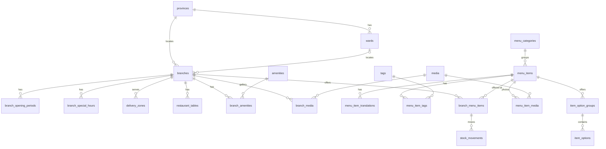
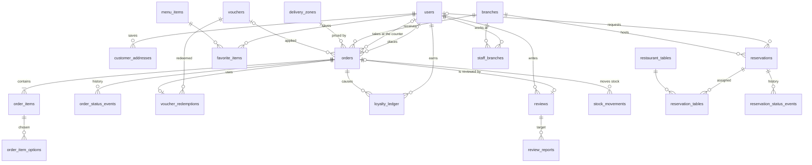
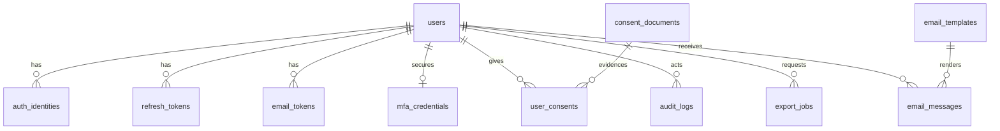
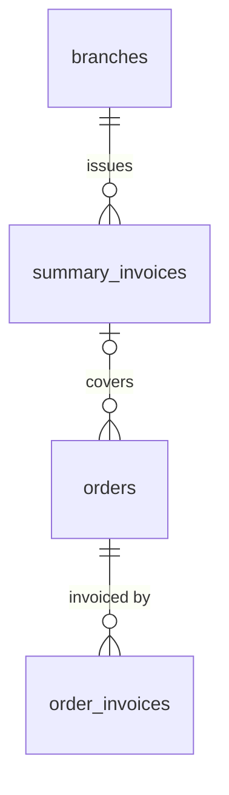

# Data model v5 (restaurant business app)

Status: **draft for review** (2026-10-27, revised 2026-10-28, 2026-10-30 and 2026-11-03). v5 follows [ADR-0009](adr/0009-owner-business-pivot.md): VER.02 is the app of the owner's own restaurant (one brand, several branches; menu, pickup and delivery orders, table reservations, loyalty and vouchers; staff operations; no in-app payment). It replaces v4, which modelled a directory of third-party venues. v4 is kept in the pre-pivot backup only; the parts that survive (auth, consent, audit, outbox, export, email, conventions) are written out in full below, so this file does not depend on v4.

**Revision of 2026-10-28 (review against the restaurant use case).** Added: `branches.code` (needed for `order_number`), `menu_items.sort_order`, `users.status = INVITED`, `orders.completed_at`, courier fields, a split of `discount_total` into voucher and points parts, `payment_status = REFUNDED`, the `payment` and expanded `ordering` settings. Fixed: customer cancel rule (only `PLACED`), stock restore only before `PREPARING`, points earned at completion, `COMPLETED` requires `PAID`, delivery orders need a pinned location, `reports` renamed `review_reports`. Written out: the auth, consent, email, export and media tables that said "as in v4". See "Findings and open items" for what is still undecided.

**Consistency pass of 2026-10-28** (all docs reviewed against this file): added `orders.delivery_note`; the API now returns the voucher and points discounts separately, has a staff config endpoint, a pause endpoint, an `order.updated` event and a resend-invitation endpoint; the scaffold plan gained the scheduled jobs and the receipts module; the data plan and the test list cover the new rules.

**Revision of 2026-10-30 (gaps of the admin web design folded in).** The owner ordered that the data gaps found by the admin web design ([designs/web/brief.md](../designs/web/brief.md), section "API and data gaps found") be folded into this file. Kinds of change: one new table (`reservation_status_events`); new columns on `orders` (dine-in and counter orders, `source`, `created_by`, `table_label`, refund fields, `cancel_reason_code`, last four digits of the phone), `order_items` (`round_no`), `branches`, `menu_items`, `users`, `reviews`, `review_reports`, `restaurant_tables`, `delivery_zones`, `promotions`, `tags`, `amenities`, `menu_item_tags`, `audit_logs` and `app_settings`; new enum values (`orders.type = DINE_IN`, the order sources, the report `decision`); new `CHECK`, unique and partial-unique constraints and indexes; a reservation transition table; the `app_settings` keys that the settings, reservations, ordering, payment and loyalty screens need, with proposed defaults; and privacy and retention rules for the new data (invoice buyer details, reservation contact without an account, `last_login_at`, audit labels). Every addition carries a `(brief ID)` tag that points at a gap row of designs/web/brief.md (for example `(brief A4)`), so that each can be traced and reviewed. Decisions the brief leaves to the owner or the accountant are not made here; they are listed as open in "Findings and open items". Gaps that are only endpoints, parameters, response shapes, error codes or events are not repeated here (they belong to api-outline.md). Everything added is a proposal until the owner confirms it, as for `app_settings`.

**Revision of 2026-11-03 (gaps of the customer mobile app folded).** The owner approved on 2026-11-03 that the data gaps found by the customer app design ([designs/mobile/brief.md](../designs/mobile/brief.md), section "API and data gaps found", rows G1 to G146) be folded into this file, in the same way as the admin web gaps on 2026-10-30. No new table is added. Kinds of change: new columns (`branches.pause_message`, `branch_special_hours.display_note`, `menu_categories.icon`); new length `CHECK`s (`order_items.note`, `customer_addresses.note`, `orders.delivery_note`, `reservations.note`, `users.display_name`); the rule `eta_at = requested_for` for a scheduled order; rules for a customer's own review (edit and hard delete only while `PUBLISHED`, no report on one's own review); how a saved voucher code and the favorites of a removed dish are stored; partial redemption of points; `app_settings` keys (`ordering.item_note_max`, proposed 10 for `call_hint_minutes`, the "complete" rule and the digits-only format of `payment`); a `review_reports` line in the account-deletion table; and derived fields for the customer menu (`hasRequiredOptions`, `lowStock`). Every addition carries a `(mobile G#)` tag (the prefix `mobile` keeps these IDs apart from the `(brief G#)` tags of the audit log) that points at a gap row of the mobile brief. Gaps that are only endpoints, parameters, response shapes, error codes or events belong to api-outline.md; gaps that depend on an open question of the mobile brief (separate menus per branch, bank details, who chooses featured dishes, the customer cancel reasons) or are sample-data or wording fixes are **not** decided here and are listed as open in "Findings and open items", item 15. Everything added is a proposal until the owner and the engineers confirm it. The row-by-row status of the 146 gaps will be written in designs/mobile/gaps-coverage.md afterwards.

**Owner answers of 2026-10-28:** keep `REFUNDED` and "`COMPLETED` needs `PAID`"; the business day needs a **cutoff hour** (added: `orders.business_date`, `app_settings.reports`); stock is taken at placement as proposed; the `ordering` values proposed in `app_settings` are accepted as defaults (`WA12` to `WA16` in ADR-0009). **Invoices, final answer:** the business is a small family household business; a **printed receipt** for each order is enough, no e-invoice is needed, daily summaries are rejected because they make the books hard to check, and the owner will give the accountant **statistical reports exported to Excel**; tax follows the general formula outside the app. An earlier draft of this file modelled invoices (`order_invoices`, `summary_invoices`, tax groups, an `InvoicePort`); all of it is removed. See "Receipts and statistics for the books".

Assumptions behind this draft that the owner has not yet confirmed are listed in ADR-0009 ("Working assumptions", written `WA#` below). Tables marked **(P2)** or **(P3)** follow the phasing of ADR-0009; the schema includes them so that later phases do not force a redesign, but API and UI delivery follows the phases.

Database: PostgreSQL with PostGIS. Extensions: `postgis`, `pg_trgm`, `unaccent`, `citext`. (`btree_gist` only if the reservation exclusion constraint below is adopted.)

**Tax and invoice position (owner, 2026-10-28; sources are secondary and the accountant should confirm).** The owner states the business is small and family-run and wants no e-invoice. The sources I read say a household business above 1 billion VND of yearly revenue must use e-invoices under Decree 254/2026/ND-CP (in force since 1 July 2026), and the revenue thresholds below which a household owes tax changed in 2026 (sources disagree between 500 million and 1 billion). So the position holds only while the business stays below the threshold that applies; watch yearly revenue (the Excel report shows it). The orders keep full transaction data (items, prices, discounts, fees, payment, timestamps), so e-invoices can be added later without a redesign. The owner confirmed that current revenue is below the threshold that applies and asked that the e-invoice adapter and two tables be **designed now**, so that enabling them is a switch and a migration: see "E-invoices (designed, deferred)". Nothing of it is built or shown in phase 1.

## Scope

| In scope | Out of scope for now |
|---|---|
| One brand, several branches, each with hours, services and staff | Franchise owners with separate books |
| Menu: categories, items, options, per-branch availability and stock | Recipes, ingredient-level inventory, purchasing |
| Pickup, delivery and dine-in (counter) orders with a status flow (dine-in: brief A1); cash or bank transfer confirmed by staff | Online payment, card data, refunds through a gateway, shipper tracking |
| Table reservations (no deposit) | Deposits, pre-ordering for a reservation, waitlist |
| Loyalty points, vouchers, promotion banners (P2) | Gift cards, subscriptions, referral rewards |
| Reviews of completed orders with an owner reply | Review photos, helpful votes, item-level ratings |
| Revenue statistics derived from orders: Excel export in phase 1, charts in P3 | A separate analytics store |
| A printed receipt for every order and statistical reports exported to Excel for the books | E-invoices through a provider (designed but deferred, see "E-invoices (designed, deferred)"); the accounting ledger and tax filing; tax calculation (done outside the app by the general formula) |
| Customer accounts, addresses, consent, personal-data lifecycle | Marketing campaigns and email to customers |
| Vietnamese content, schema ready for more languages | English content entry |

## Conventions

- **Primary keys:** `uuid` with a default of `uuidv7()` (native in PostgreSQL 18); otherwise the application generates UUIDv7.
- **Timestamps:** `timestamptz`, `created_at` and `updated_at` on every mutable table. Dates with no time of day use `date`.
- **Names:** `snake_case`, plural table names.
- **Text:** `text` with `CHECK` length limits. Email uses `citext`. Phone numbers are E.164. For the phone of a customer (`users.phone`, `customer_addresses.phone`, `orders.customer_phone`) the API accepts the national form and stores the E.164 form, Vietnamese mobile numbers in the first release; the exact pattern is written in api-outline.md (mobile G97). A branch phone may be a landline, such as the hotline.
- **Money:** integer VND, never floating point. Every money column is `>= 0` by `CHECK`.
- **Enums:** native PostgreSQL enums for closed sets. Admin-managed vocabularies are tables.
- **Translations:** searchable long text lives in `<entity>_translations`; short labels live in a `names jsonb` column with a required `vi` key (`CHECK (names ? 'vi')`). Proper names (brand, branch, voucher code) are not translated.
- **Snapshots:** an order copies the name and price of everything it contains (items, options, customer contact, delivery address). Later edits to the menu or the profile never rewrite a past order.
- **Append-only history:** `order_status_events`, `reservation_status_events` (brief P3), `stock_movements`, `loyalty_ledger`, `user_consents` and `audit_logs` are never updated or deleted by the application role (it has `INSERT` only on them).
- **No cart table:** the cart lives on the customer's device. The server sees it only as the body of `POST /orders/quote` and `POST /orders` and recomputes every price. It stays device-local in the first release; syncing it across devices would need a table keyed by branch and user with a version, which is not designed (mobile G119; whether it survives sign-out is open).
- **Deletion:** `deleted_at` on `branches`, `menu_items`, `customer_addresses`; orders are **never** deleted; users are anonymised in place (see Personal data lifecycle). Vouchers are never deleted, only switched off (brief M6); a category is hard-deleted only when no item references it (brief B25).
- **Time zone:** one zone (`Asia/Ho_Chi_Minh`) as configuration, not a column. "Day" in reports and order numbers means a day in that zone.
- **Optimistic concurrency:** `row_version` on editable records that two staff may touch (`branches`, `menu_items`, `menu_categories`, `branch_menu_items`, `vouchers`, `email_templates`) and on `orders` and `reservations`; added by the brief: `delivery_zones` (C23), `tags` and `amenities` (B24), `reviews` (V3), `restaurant_tables` (P16), `promotions` (M13) and, per key, `app_settings` (L1). `users` has none (brief E4: two admins rarely edit one person).

## ER diagrams

### Business, menu and branches

### Customers, orders, reservations, loyalty

### Identity, privacy and system

`outbox_events`, `app_settings` and `order_counters` are standalone.

## Tables

### Geography

| Table | Columns | Notes |
|---|---|---|
| `provinces` | `code` (PK, official code), `names jsonb`, `type` (`CITY` \| `PROVINCE`) | Seeded from the official list ([data/admin-units](../data/admin-units/README.md)); rows updated in place when the list changes. Used for branch and customer addresses. |
| `wards` | `code` (PK), `province_code` → provinces, `names jsonb`, `type` (`WARD` \| `COMMUNE` \| `SPECIAL_ZONE`) | Unique on (`code`, `province_code`). No district level (abolished 1 July 2025). |

### Branches

| Table | Columns | Notes |
|---|---|---|
| `branches` | `id`, `code` (unique, 2 to 4 uppercase letters, for example `BT`), `slug` (unique), `name`, `description jsonb` (nullable, `vi` key when present), `address_line`, `province_code`, `ward_code` (nullable), `location geography(Point,4326)` (**required**), `phone` (E.164), `status` (`ACTIVE` \| `TEMPORARILY_CLOSED` \| `CLOSED`), `accepts_pickup`, `accepts_delivery`, `accepts_reservations`, `default_prep_minutes`, `order_cutoff_minutes`, `reservation_duration_minutes` (brief P19), `reservation_slot_step_minutes` (brief P19), `reservation_max_party`, `reservation_lead_minutes`, `reservation_max_days_ahead`, `cover_media_id` (nullable), `website_url` (nullable; brief C28), `pause_message` (nullable, at most 200 characters; mobile G11), `sort_order`, `review_count`, `rating_sum`, `row_version`, `updated_at` (brief C10), `updated_by` (nullable → users; brief C10), `deleted_at` | The restaurant's own locations: a handful of rows, placed by hand on a map. `code` is the prefix of every `order_number` and never changes once an order exists. `order_cutoff_minutes` stops taking orders that long before closing. `status = TEMPORARILY_CLOSED` is also the staff "pause orders" switch: a `STAFF` user may flip only between `ACTIVE` and `TEMPORARILY_CLOSED` (audited); `CLOSED` is set by `MANAGER` or `ADMIN`. Orders already in progress are not affected by a pause. Reservation settings live here to keep the table count down. A branch cannot accept delivery without at least one active `delivery_zones` row (checked when enabling). **Brief additions:** `reservation_duration_minutes` (default 90) and `reservation_slot_step_minutes` (start-time step, 15 or 30) replace the single `reservation_slot_minutes`, which the frames read two ways, as the length of one booking and as the start-time step (brief P19); `reservations.duration_minutes` takes its default from `reservation_duration_minutes`. `CHECK`s: duration 30 to 240 in steps of 15, `reservation_max_party >= 1` (the API also keeps it at or below the active seats of the branch), `reservation_lead_minutes` 0 to 1440, `reservation_max_days_ahead` 1 to 90 (brief P21). `cover_media_id` is kept equal to the `branch_media` row with `position = 0` by the API; dropping the column is the alternative (brief C29). `website_url` is one optional https link of at most 255 characters; a `branch_contacts` table is not added (brief C28). `updated_at` and `updated_by` change on any edit of the branch, hours, zones or gallery included, and feed the conflict message of `row_version` (brief C10). `location` stays required: a new branch is created only after the pin is placed (brief C5, open). Soft delete (`deleted_at`) is for `ADMIN` only and is refused while the branch has orders in progress or upcoming reservations, or when it is the last active branch (brief C1). `code` is locked once an order exists: the API refuses a change and the read model exposes `codeLocked` (brief C6). The last active `delivery_zones` row cannot be switched off or deleted while `accepts_delivery` is true (brief C21). **Customer app addition (mobile G11):** `pause_message` is the line a manager may type when pausing orders (the pause call has only an optional `reason` today, brief A25); the customer app shows it on a `TEMPORARILY_CLOSED` branch and drops the line when it is empty. Whether resuming clears it is not stated. |
| `branch_opening_periods` | `id`, `branch_id`, `service` (`STORE` \| `DELIVERY`), `day_of_week` (1-7, Monday = 1), `open_time`, `close_time`, `closes_next_day` | One row per period (a day with a lunch and a dinner shift has two rows). `CHECK (open_time <> close_time)` and `closes_next_day` is true exactly when `close_time <= open_time`. `DELIVERY` rows are optional; without them delivery follows `STORE`. Pickup and reservations follow `STORE`. Periods of one branch, service and day must not overlap, also across midnight into the next day (checked by the API; brief C15). A 24-hour day is stored as 00:00 to 23:59, which leaves a one-minute gap if the next day also opens; adding `is_24h` and relaxing the `CHECK` is the alternative (brief C11, open). |
| `branch_special_hours` | `id`, `branch_id`, `service`, `starts_on`, `ends_on`, `is_closed`, `open_time`, `close_time`, `closes_next_day`, `note`, `display_note` (nullable; mobile G12) | Holidays (Tết) and one-off changes override the weekly periods for the dates covered. `note` is internal and is not shown to customers; showing it (for example "Nghỉ Tết") would need a display field and translations (brief C13). **Customer app addition (mobile G12):** `display_note` is that customer-facing field, plain Vietnamese text such as "Nghỉ Tết"; a day with a null `display_note` shows only "special schedule". Its length limit and translations are not decided. Date ranges of one branch and service must not overlap: the API checks it, and an `EXCLUDE USING gist` constraint over `daterange(starts_on, ends_on, '[]')` is the alternative (needs `btree_gist`; brief C14). A closed store day closes delivery too: effective delivery hours are the delivery hours (weekly or special) intersected with the effective store hours (brief C12). |
| `delivery_zones` | `id`, `branch_id`, `name`, `radius_m`, `fee`, `min_order`, `free_over` (nullable), `eta_minutes`, `is_active`, `row_version` (brief C23) | Concentric rings by straight-line distance from the branch (PostGIS `ST_DWithin`); the smallest ring containing the address wins (WA2). `free_over` is compared with the order `subtotal` before any discount; `min_order` likewise. Polygons and road distance are later options. `fee >= 0`, `radius_m > 0`. **Brief additions:** also `CHECK (min_order >= 0)`, `CHECK (free_over IS NULL OR free_over > min_order)` and `CHECK (eta_minutes > 0)` (brief C20); unique on (`branch_id`, `radius_m`) among active rows, so the smallest-ring rule has one answer (partial unique index; brief C19); `orders.delivery_zone_id` is `RESTRICT`, so a zone with orders cannot be deleted (`IN_USE`) and "stop using" is `is_active = false` (brief C22); creating, changing and deleting a zone is audited (`delivery_zone.create`, `.update`, `.delete`; brief C25). |
| `amenities` | `id`, `code` (unique), `names jsonb`, `icon`, `row_version` (brief B24) | Wifi, parking, air conditioning, outdoor seating, private room, kid friendly, wheelchair access... Shown on the branch page. `icon` is one key of a fixed list (`wifi`, `car`, `snow`, `tree`, `door`, `child`, `wheelchair`, `box`) checked by the API, not by a `CHECK`, so the list can grow; who owns the list is open (brief B32). An amenity that a branch uses cannot be deleted (`RESTRICT`, `IN_USE`; brief B24). |
| `branch_amenities` | `branch_id`, `amenity_id` | PK on both. |
| `branch_media` | `branch_id`, `media_id`, `position` | PK (`branch_id`, `media_id`); position 0 is the cover. Unique on (`branch_id`, `position`), `DEFERRABLE INITIALLY DEFERRED`, because the API rewrites the whole list in one transaction (brief C30). At most 12 photos per branch, checked by the API (brief C32, R4; whether the limit is fixed or an `app_settings` value is open). |
| `restaurant_tables` | `id`, `branch_id`, `name`, `seats`, `area` (nullable), `is_active`, `row_version` (brief P16) | Unique on (`branch_id`, `name`). Used by reservations and the table screen. **Brief additions:** `CHECK`s: `name` 1 to 20 characters, `seats` 1 to 20, `area` at most 40 characters (brief P21); `area` is free text, and the screen suggests the values already used (brief P22). Tables are listed by name in natural (numeric) order; there is no `sort_order` (brief P17). A table cannot be switched off, or have its seats reduced below the party it holds, while a `CONFIRMED` or `SEATED` reservation that is unfinished uses it, and it can be deleted only when it is switched off and was never used (`reservation_tables.table_id` is `RESTRICT`; `IN_USE`; brief P15, P23). The number of reservations holding a table (`holdingCount`) and `seatedNow` are derived (brief P23). `orders.table_label` is not linked to this table (brief P10, open). |

### Menu

| Table | Columns | Notes |
|---|---|---|
| `menu_categories` | `id`, `slug` (unique), `names jsonb`, `icon` (nullable; mobile G6), `sort_order`, `is_active`, `row_version` | Shared by all branches. `icon` is one key of a fixed list checked by the API, like `amenities.icon`, for the category row of the customer Home; the list of keys is not written yet (mobile G6). A hidden category (`is_active = false`) hides its items from customers (brief B29). A category is hard-deleted only when no item, soft-deleted ones included, references it (`menu_items.category_id` is `RESTRICT`; `IN_USE`; brief B25, B26). |
| `menu_items` | `id`, `slug` (unique), `category_id`, `base_price`, `prep_minutes` (nullable), `sort_order`, `is_active`, `row_version`, `updated_at` (brief B1), `updated_by` (nullable → users; brief B1), `deleted_at` | One definition of a dish for the whole brand. Per-branch availability and price live in `branch_menu_items`. Item-level ratings are not collected (WA6), so no rating columns here. **Brief additions:** `updated_at` and `updated_by` change on any content edit, translations, tags, options and photos included (brief B1). An item can be switched on (`is_active = true`) only with a `vi` name, `base_price > 0`, a cover photo and at least one `branch_menu_items` row; while it is on, its last cover photo and its last branch row cannot be removed (checked by the API; brief B6, B8). At most 8 photos per item, checked by the API (brief B15, R4; whether the limit is fixed or an `app_settings` value is open). Deleting an item is the soft delete above; the app has no restore (brief B5). |
| `menu_item_translations` | `menu_item_id`, `locale`, `name`, `description` | PK (`menu_item_id`, `locale`). A `vi` row is required before an item can be made active. |
| `tags` | `id`, `kind` (`DIETARY` \| `ALLERGEN` \| `LABEL`), `slug` (unique), `names jsonb`, `row_version` (brief B24) | Vegetarian, vegan, halal; allergens (peanut, shellfish...); labels (best seller, new, spicy). `ALLERGEN` tags are a consumer-safety claim: staff must confirm them (below). `row_version` is added for the tag screen (brief B24). The `kind` of a tag that has items cannot be changed, and a tag in use cannot be deleted (`menu_item_tags.tag_id` is `RESTRICT`; `IN_USE`; brief B30, B24). |
| `menu_item_tags` | `menu_item_id`, `tag_id`, `verified_at` (nullable), `verified_by` (nullable → users; brief B13) | PK on both. `verified_at` is null until a manager confirms the claim; the apps label unverified dietary and allergen claims. `verified_at` and `verified_by` are set together: false to true sets both, true to false clears both, an unchanged flag keeps them; only `MANAGER` and `ADMIN` verify, and each change is audited (brief B13, B14). |
| `item_option_groups` | `id`, `menu_item_id`, `names jsonb`, `min_select`, `max_select`, `sort_order` | For example "Size" (1 to 1) or "Topping" (0 to 3). `CHECK (0 <= min_select AND min_select <= max_select)`. The API also checks that a default exists when exactly one choice is required, that defaults do not exceed `max_select`, that enough options are active for `min_select`, and that the group has a `vi` name (brief B9). |
| `item_options` | `id`, `group_id`, `names jsonb`, `price_delta` (integer, may be 0, not negative), `is_default`, `is_active`, `sort_order` | A choice inside a group. Global active flag; per-branch option availability is not modelled (limitation: mark the whole item unavailable instead; accepted for the first release, mobile G35). Groups belong to one item, so "Size" is repeated on each drink; the seed tool and the editor can copy a group, and shared group templates are a later option. |
| `menu_item_media` | `menu_item_id`, `media_id`, `position` | PK on both; position 0 is the cover. |
| `branch_menu_items` | `branch_id`, `menu_item_id`, `is_available`, `price_override` (nullable), `stock_qty` (nullable), `low_stock_threshold` (nullable), `row_version`, `updated_at` | PK (`branch_id`, `menu_item_id`). **No row means the branch does not offer the item.** `stock_qty` null means stock is not tracked; when set, `CHECK (stock_qty >= 0)` so an order cannot oversell. Effective price = `price_override` or `menu_items.base_price`. **Brief additions:** `CHECK (price_override > 0)` and `CHECK (low_stock_threshold >= 0)` (brief B22); a null `low_stock_threshold` never means "low", only `stock_qty = 0` means sold out (brief F7); a row is created when staff mark an item as sold at the branch and deleted when they stop selling it there (brief B19); starting or stopping stock tracking writes an `ADJUST` movement and an `audit_logs` row, and stopping sets `stock_qty` to null with a movement of minus the remaining quantity (none when it was 0) (brief B23). |
| `stock_movements` | `id`, `branch_id`, `menu_item_id`, `delta` (non-zero integer), `reason` (`ORDER` \| `ORDER_CANCEL` \| `ADJUST` \| `RESTOCK`), `order_id` (nullable), `note`, `created_by` (nullable for system), `created_at` | Append-only trail for "quản lý tồn". `stock_qty` is changed in the same transaction as the movement row and reconciled nightly against the sum of movements. |
| `media` | `id`, `storage_key` (unique), `content_type`, `width`, `height`, `bytes`, `sha256`, `blurhash`, `alt_text`, `uploaded_by` → users | Every image is a row here. `blurhash` lets the mobile app show a placeholder while the image loads; `sha256` prevents duplicate uploads. `alt_text` is at most 200 characters (`CHECK`; brief C32) and belongs to the `media` row, so editing it changes every place the image is used; moving it to the link tables is the alternative (brief B18). The API validates uploads from `content_type`, `bytes`, `width` and `height`: photos at most 10 MB (brief B16), logos PNG, JPEG or WebP, at most 2 MB, at least 256 px, no SVG (brief L5), banners ratio 2:1 and at least 600 x 300 (brief M16). |

### Users, roles and identity

| Table | Columns | Notes |
|---|---|---|
| `users` | `id`, `email` (unique, `citext`), `password_hash` (nullable), `display_name` (at most 60 characters, `CHECK`; mobile G95), `phone` (E.164, nullable), `avatar_url`, `locale`, `role` (`CUSTOMER` \| `STAFF` \| `MANAGER` \| `ADMIN`), `status` (`INVITED` \| `ACTIVE` \| `SUSPENDED` \| `DELETED`), `preferred_branch_id` (nullable), `email_verified_at`, `failed_login_count`, `locked_until`, `last_login_at` (nullable; brief E3), `deleted_at` | One table for customers and staff. `phone` is required to place an order and is **not verified** in the first release (WA10; staff may call). `ADMIN` is the owner and sees all branches. `INVITED` is a staff account whose invitation link has not been used (no password yet); it cannot log in. Staff who leave are `SUSPENDED`, never deleted, because orders and the audit trail point to them. **Brief additions:** `last_login_at` is set when a sign-in completes, after the second step for `MANAGER` and `ADMIN` (brief E3). A wrong password and a wrong TOTP code both increment `failed_login_count`; the lock message does not reveal the unlock time, the attempts left or which factor failed (brief E15). A role change revokes every `refresh_tokens` row of the person (`revoked_at`); a branch change does not (brief E6). |
| `staff_branches` | `user_id`, `branch_id` | PK on both. A `STAFF` or `MANAGER` must have at least one row (checked by the API); every order, reservation and report query is filtered by the caller's rows. `ADMIN` ignores the table. |
| `customer_addresses` | `id`, `user_id`, `label`, `recipient_name`, `phone` (E.164), `address_line`, `province_code`, `ward_code` (nullable), `location geography(Point,4326)` (**required**: the customer drops a pin; the delivery zone is computed from it), `note` (at most 200 characters, `CHECK`; mobile G46), `is_default`, `deleted_at` | Personal data; deleted with the account. At most one default per user (partial unique index). The number of saved addresses per person (the brief says "for example 10") is checked by the API and is open (mobile open question 8). |
| `auth_identities` | `id`, `user_id`, `provider` (`GOOGLE` \| `APPLE`), `provider_subject` | Social sign-in for customers on mobile only ([ADR-0003](adr/0003-authentication.md)). Unique on (`provider`, `provider_subject`). Staff never use it. |
| `refresh_tokens` | `id`, `user_id`, `token_hash`, `family_id`, `device_label`, `expires_at`, `used_at`, `revoked_at`, `last_used_at` | Hashes only. Single use, family revocation on reuse (ADR-0003). `device_label` lets a user see and revoke sessions. |
| `email_tokens` | `id`, `user_id`, `type` (`VERIFY_EMAIL` \| `RESET_PASSWORD` \| `INVITE`), `channel` (`CODE` \| `LINK`), `token_hash`, `target_email` (`citext`), `attempts`, `max_attempts`, `expires_at`, `used_at` | Single use, hashed. Customers use `CODE`: 6 digits stored as a keyed hash (HMAC), lifetime 10 minutes, `max_attempts` 5; a wrong guess increments `attempts` and the code dies at the limit. Staff use `LINK`: `INVITE` lives 48 hours, staff `RESET_PASSWORD` 30 minutes. `target_email` is where the message went, which may differ from `users.email` (the "another email" path); the API checks it before sending. At most one live token per (`user_id`, `type`); issuing a new one expires the old one (ADR-0008 #1, #2). |
| `mfa_credentials` | `user_id` (PK), `secret_encrypted`, `enabled_at`, `last_used_step`, `recovery_code_hashes` (text[]) | **Accepted** (ADR-0009, risk 1): TOTP for `MANAGER` and `ADMIN`, built with the staff auth slice. `last_used_step` stops a code being replayed. Recovery codes are shown once and stored hashed; there are ten, the admin shows a warning at three left and requires a new set when none are left (brief E20, needs confirmation). |

### Orders

| Table | Columns | Notes |
|---|---|---|
| `orders` | `id`, `order_number` (unique), `branch_id`, `customer_id` → users (nullable for a counter order with no account; brief A3), `type` (`PICKUP` \| `DELIVERY` \| `DINE_IN` (brief A1)), `source` (`APP` \| `COUNTER` \| `PHONE`, default `APP`; brief A2), `created_by` → users (nullable: the staff member who typed the order, null for a customer's own; brief A2), `table_label` (nullable, at most 20 characters; brief A5), `status`, `payment_method` (`CASH` \| `BANK_TRANSFER`), `payment_status` (`UNPAID` \| `PAID` \| `REFUNDED`), `paid_at`, `paid_confirmed_by`, `refunded_at` (nullable; brief A18), `refunded_by` (nullable → users; brief A18), `subtotal`, `voucher_discount`, `points_discount`, `discount_total`, `delivery_fee`, `total`, `voucher_id` (nullable), `voucher_code` (snapshot), `points_redeemed`, `points_earned`, `requested_for` (nullable = as soon as possible), `eta_at` (nullable), `customer_name`, `customer_phone` (both nullable only when `customer_id` is null; brief A3, J21), `customer_phone_last4` (generated from `customer_phone`, nullable; brief A36), `customer_note`, `delivery_address_text` (street line), `delivery_ward_code` (nullable), `delivery_province_code`, `delivery_location` (nullable), `delivery_note` (nullable, at most 200 characters, `CHECK`; mobile G46; copied from the address note and editable at checkout: gate, alley, floor), `delivery_zone_id` (nullable), `courier_name` (nullable), `courier_phone` (nullable), `cancel_reason`, `cancel_reason_code` (nullable; brief J106), `cancelled_by` (`CUSTOMER` \| `STAFF` \| `SYSTEM`; a `REJECTED` order carries `STAFF`, brief A40), `idempotency_key`, `placed_at`, `completed_at` (nullable), `business_date` (date, nullable), `updated_at`, `row_version` | `status` is `PLACED` → `ACCEPTED` → `PREPARING` → `READY` → (`OUT_FOR_DELIVERY`) → `COMPLETED`, or `CANCELLED` / `REJECTED` (see transitions). `order_number` is `{branches.code}-{yyMMdd}-{seq}` (Vietnam date, 4-digit sequence per branch and day, for example `BT-261027-0042`); a bank-transfer customer writes it in the transfer note. **Arithmetic:** `CHECK (discount_total = voucher_discount + points_discount)`, `CHECK (total = subtotal - discount_total + delivery_fee)`, `CHECK (total >= 0)`; `subtotal` is the sum of `order_items.line_total` before any discount (checked by the API and by tests, since a `CHECK` cannot span rows). Points are worth `points_redeemed` × the VND value in `app_settings.loyalty`, stored as `points_discount`. **Shape:** `CHECK`: `delivery_address_text`, `delivery_province_code`, `delivery_location` and `delivery_zone_id` are present exactly when `type = DELIVERY`, and `delivery_note` is null for pickup; `delivery_fee = 0` and `courier_*` null for pickup. **Payment:** `paid_at` and `paid_confirmed_by` are set exactly when `payment_status = PAID` or `REFUNDED`; `CHECK (status <> 'COMPLETED' OR payment_status = 'PAID')` (an order is completed only after staff confirm the money was received, in the same action if needed); `CHECK (payment_status <> 'REFUNDED' OR status IN ('CANCELLED', 'REJECTED'))`. **Other:** `completed_at` is set exactly when `status = COMPLETED`; `business_date` is set at the same moment to the restaurant's business day (the Vietnam date of `completed_at` minus `app_settings.reports.business_day_starts_at`, so an order finished at 00:30 with a 04:00 cutoff belongs to the previous day) and is what revenue reports group by. It is stored, not computed, so changing the cutoff later does not rewrite history. `courier_name` and `courier_phone` are typed by staff when the order goes `OUT_FOR_DELIVERY` (own staff, WA2; the courier need not have an account). Unique on (`customer_id`, `idempotency_key`) so a retried request never creates a second order. Customer contact and address are snapshots. `voucher_id` and `points_*` exist in phase 1 as empty columns; the foreign key to `vouchers` is added by the phase 2 migration. **Counter and dine-in orders (brief A1 to A9, J21, J109).** `type = DINE_IN` is shaped like `PICKUP`: the shape `CHECK`s that name pickup apply to it too (no delivery fields, no courier, `delivery_fee = 0`). `table_label` is only for `DINE_IN` and may stay empty. `source` says where the order came from: `APP` for a customer's own order, `COUNTER` or `PHONE` for one that staff typed; `created_by` is the staff member for the latter and null for `APP` (`CHECK`: `source = 'APP'` exactly when `created_by IS NULL`). `customer_id` is null for a counter order with no account (shown as `Khách tại quầy`); then `customer_name` and `customer_phone` may be null too, and the order has no voucher or points because both need a user; `CHECK`: all three are present when `source = 'APP'`. The idempotency unique index is on (`customer_id`, `idempotency_key`) for orders with a customer and on (`created_by`, `idempotency_key`) for orders without one (brief A3, A4; my reading of the two gaps). A counter order is created directly at `ACCEPTED`: its first `order_status_events` row has `from_status` null, `to_status = ACCEPTED` and the staff member as actor, stock is taken in the same transaction, and the kitchen starts at once, also while a bank transfer is unconfirmed (brief A4, decision 6). A dine-in order is one order with one payment per table (no split payment, brief A12); staff can add items while it is unpaid and not final, each addition is a round (`order_items.round_no`), and the same transaction deducts stock, recomputes `subtotal` and `total`, and sends a `READY` order back to `PREPARING` (brief A6, A7; rules awaiting the owner's confirmation). **Other brief additions.** `refunded_at` and `refunded_by` are set exactly when `payment_status = REFUNDED`; the refund amount is the order `total` (no partial refunds), so there is no amount column (brief A18). `cancel_reason_code` (`OUT_OF_STOCK` \| `DELIVERY_FAILED` \| `CUSTOMER_CHANGED_MIND` \| `OTHER`; the values are examples, a native enum once chosen) lets statistics group cancellations; `cancel_reason` stays the free note; staff set the code when they cancel or reject, and a customer's own cancellation may leave it null because it needs no reason today (brief J106). When staff cancel or reject, `cancel_reason` is also copied to the `note` of the status event, so the customer can see why (brief A26). `customer_phone_last4` is a stored generated column, indexed for search by the last digits; it is personal data and is scrubbed with the phone; dropping that search is the alternative (brief A36). `table_label` is searched by prefix (brief A5). The note flag of an order is derived from `customer_note` and any `order_items.note` (brief A19). **Customer app addition (mobile G59):** when `requested_for` is set, `eta_at` equals `requested_for` (proposal; stated so that the app does not guess). |
| `order_items` | `id`, `order_id`, `menu_item_id`, `name_snapshot`, `unit_price`, `quantity` (1-99), `line_total`, `note` (at most 200 characters, `CHECK`; mobile G32), `round_no` (integer >= 1, default 1; brief A6) | `unit_price` is the price at order time including chosen option deltas; `line_total = unit_price * quantity` by `CHECK`. `menu_item_id` stays a real foreign key (items are soft-deleted, so history never dangles). `round_no` is the round of a dine-in order: 1 at creation, then one more for each addition (brief A6). Allergen and diet tags are not captured on the line: the order detail reads the item's current tags, and a snapshot into `order_items` (jsonb) is the alternative (brief A17, open). |
| `order_item_options` | `id`, `order_item_id`, `option_id` (nullable), `group_name_snapshot`, `option_name_snapshot`, `price_delta` | Snapshot of each chosen option. |
| `order_status_events` | `id`, `order_id`, `from_status` (nullable), `to_status`, `actor_user_id` (nullable for system), `note`, `created_at` | Append-only. The first row (`from_status` null, `PLACED`) is written with the order. Source of timing metrics (time to accept, to ready). A counter order's first row is `ACCEPTED`, written by staff, so averages of time to accept leave counter orders out (brief A4, F5). Time in the current status is derived from the latest row (brief A24). **Customer app addition (mobile G72):** the customer's timeline reads the `note` and a role label only (customer, restaurant or system); `actor_user_id`, and so a staff member's name, never reaches a customer. |
| `order_counters` | `branch_id`, `day` (date), `last_value` | Increments atomically (one row per branch and Vietnam date, locked while the order is created) to build the sequence part of `order_number`. |

**Allowed status transitions** (enforced by the API, recorded in `order_status_events`; a transition outside this list returns `409`):

| From | To | Who |
|---|---|---|
| `PLACED` | `ACCEPTED`, `REJECTED` | staff of the branch |
| `PLACED` | `CANCELLED` | customer (only while `PLACED`; after that they call the branch) |
| `PLACED`, `ACCEPTED`, `PREPARING`, `READY`, `OUT_FOR_DELIVERY` | `CANCELLED` | staff, with a required reason (for example a pickup no-show at `READY`, a failed delivery) |
| `ACCEPTED` | `PREPARING` | staff |
| `PREPARING` | `READY` | staff |
| `READY` | `COMPLETED` (pickup, or dine-in labelled `Đã phục vụ`; brief A9) or `OUT_FOR_DELIVERY` (delivery) | staff |
| `READY` | `PREPARING` (`DINE_IN` only, when staff add a round; brief A7, A9) | staff |
| `OUT_FOR_DELIVERY` | `COMPLETED` | staff |

`COMPLETED`, `CANCELLED` and `REJECTED` are final. A system cancel (`cancelled_by = SYSTEM`, from `PLACED` only) exists if the owner enables auto-cancel of unconfirmed orders (`app_settings.ordering`); its status event has a null `actor_user_id` and a note, `cancel_reason` is a fixed text ("Quán không xác nhận kịp"), and the wait must exceed the board's accept late threshold; whether the wait counts from `placed_at` or from `requested_for`, the job interval and how the customer is told are open (brief L8). A counter order is created directly at `ACCEPTED` (see `orders`), and a `DINE_IN` order also needs `payment_status = PAID` to reach `COMPLETED`, like every order.

**Side effects, all in the same transaction as the status change:**

| Event | Stock | Voucher | Points |
|---|---|---|---|
| Order placed | Decremented (`ORDER` movement) for items with tracked stock, so two customers cannot take the last portion | Redemption written | Redeemed points deducted (`REDEEM_ORDER`) |
| `REJECTED`, or cancelled while `PLACED` or `ACCEPTED` | Restored (`ORDER_CANCEL` movement) | Redemption reversed | Redeemed points returned (`REVERSE_REDEEM`) |
| Cancelled from `PREPARING` onward | **Not restored automatically** (the food may already be made); the staff dialog asks, and if they confirm, an `ORDER_CANCEL` movement is written | Reversed | Returned |
| `COMPLETED` | none | none | Earned points credited (`EARN_ORDER`); `points_earned` and `completed_at` set |

Cancelling an order with `payment_status = PAID` leaves it `PAID` until staff return the money by hand (outside the app) and mark it `REFUNDED`; the board shows such orders as "cần hoàn tiền". Whether stock was restored after `PREPARING` is read from the `ORDER_CANCEL` movement; no flag is stored on the order (brief A21). Taking stock at `PLACED` lets a customer tie up stock with an order they never collect; rate limiting, the phone-call check and the staff reject action are the controls (no deposit exists).

### Receipts and statistics for the books

No tables. Two features read the order tables.

**Printed receipt.** Staff print a receipt for an order from the order detail (the shop's receipt printer; the browser print dialog with a narrow print layout). Content: business name, branch address and phone, optional tax code, order number, date and time, type (pickup or delivery), customer first name (and, for delivery, the address and phone the courier needs), each line with options, quantity, unit price and line total, subtotal, voucher and points discounts, delivery fee, total, payment method and status, the receipt footer. The lines, prices, totals, customer and payment come from the order snapshots; the business name, branch address and phone, tax code, title and footer come from the current branch and `app_settings` values, so a reprint after a settings change can differ from the original unless the owner chooses to snapshot them into the order at completion (brief A22, open). Settings (`app_settings.brand.receipt`): title (default `HÓA ĐƠN BÁN HÀNG`; whether this wording is acceptable is the owner's or accountant's call), footer text, paper width (58 or 80 mm), whether to show the tax code. Reading a delivery customer's contact for the receipt is audited like any contact reveal. A receipt is not an e-invoice and the app says nothing about its legal status.

**Statistics for the books.** An Excel (`XLSX`) report built from `COMPLETED` orders, grouped by `business_date` (revenue day, with the cutoff in `app_settings.reports`), for a date range and one or all of the caller's branches. Sheets: (1) `Theo ngày`: per day and branch, order count, goods subtotal, discounts (voucher, points), delivery fees, total, and the total split by cash and bank transfer; (2) `Theo món`: item, quantity, revenue; (3) `Chi tiết đơn`: one row per order (number, date, branch, type, payment method, subtotal, discounts, fee, total, status of payment), contact columns masked unless a reason is given; (4) `Đơn hủy và hoàn tiền`: cancelled and rejected orders with reasons and any `REFUNDED` amounts, which are listed beside, never netted into, the revenue; (5) `Tổng năm`: revenue of the year to date, so the owner sees the figure the tax thresholds depend on. Money is whole VND, dates are `dd/MM/yyyy`, the file is UTF-8 so Vietnamese opens correctly. It is an `export_jobs` row (`resource = REVENUE`), branch scoped, audited. A `DINE_IN` order shows type `Ăn tại quán`, and a counter order without a customer shows `Khách tại quầy` and no phone (brief J21). Cancelled and rejected orders have no `business_date`, so the `Đơn hủy và hoàn tiền` sheet dates them by the business date of their cancel or reject event, worked out from `order_status_events` with the current cutoff; adding `orders.closed_business_date` is the alternative (brief J12). Which columns the accountant wants on each sheet is the design's guess until the accountant reviews it (brief R3, open).

### E-invoices (designed, deferred)

Not built in phase 1: no migration, no screen and no endpoint is delivered until the owner enables it (the `InvoicePort` interface and the two table definitions below are the agreed design). Triggers: yearly revenue approaches the threshold that applies to a household business (the Excel report's `Tổng năm` sheet shows it), or the tax office or the accountant asks for it. Enabling means: write and apply the migration, turn on the feature flag `einvoice`, fill `app_settings.tax`, choose a provider and write its adapter.

| Table | Columns | Notes |
|---|---|---|
| `order_invoices` | `id`, `order_id` → orders, `buyer_type` (`RETAIL` \| `INDIVIDUAL` \| `COMPANY`), `buyer_name` (nullable), `buyer_tax_code` (nullable), `buyer_address` (nullable), `buyer_email` (nullable), `status` (`PENDING` \| `ISSUED` \| `FAILED` \| `CANCELLED` \| `REPLACED`), `created_at`, `total`, `tax_method` (snapshot), `tax_lines jsonb` (`[{ label, rate, amount }]` as the provider returned them), `provider` (nullable), `provider_invoice_id` (nullable), `series` (nullable), `invoice_number` (nullable), `lookup_code` (nullable), `issued_at` (nullable), `issued_by` (nullable = automatic), `error_code` (nullable), `replaced_by_id` (nullable), `cancel_reason` (nullable), `row_version` | An invoice for one order. `RETAIL` is a sale to a consumer with no details ("Bán cho người tiêu dùng": buyer fields empty); `INDIVIDUAL` and `COMPANY` need name and address, and `COMPANY` a 10 or 13 digit tax code. `CHECK`: `total` equals the order's `total`; `ISSUED` rows have `invoice_number`, `series` and `issued_at`. At most one live row per order (partial unique index on `status IN (PENDING, ISSUED)`). Created when the order becomes `COMPLETED` (or at checkout when the customer gave buyer details); a `PENDING` row of an order that is cancelled or rejected becomes `CANCELLED`; issued within `tax.invoice_due_hours` of `completed_at`. An issued invoice is never edited: a mistake is `CANCELLED` or `REPLACED` with a reason. **Brief additions:** a `PENDING` or `FAILED` invoice can get or change its buyer details also after the order is `COMPLETED`, otherwise `BUYER_INVALID` cannot be fixed and a guest who asks after the meal cannot be served (brief N4). Replacing an issued invoice marks the old row `REPLACED` (with `replaced_by_id`) and creates the new `PENDING` row in one transaction, because the partial unique index allows only one live row per order (brief N3). Unique on (`series`, `invoice_number`) where both are set (one seller; brief N7). The due time is `completed_at` plus `tax.invoice_due_hours`, and the invoice queue lists only invoices of `COMPLETED` orders (brief N2, N9). |
| `summary_invoices` | `id`, `branch_id`, `business_date`, `status` (as above), `order_count`, `total`, `tax_method`, `tax_lines jsonb`, `provider`, `provider_invoice_id`, `series`, `invoice_number`, `lookup_code`, `issued_at`, `issued_by`, `error_code`, `cancel_reason`, `row_version`, `created_at` | One end-of-day invoice for the completed orders of a branch and `business_date` that have no `order_invoices` row. Used only if the accountant chooses `DAILY_SUMMARY` (the owner dislikes it because it makes the books harder to check, so it is an option, not the default). Unique on (`branch_id`, `business_date`) among live rows. A nightly job after the business-day cutoff creates the `PENDING` row and sets `orders.summary_invoice_id` (a nullable foreign key added by the same migration) on every covered order, so the detail of each transaction can be given on request; `order_count` and `total` must equal those orders. Unique on (`series`, `invoice_number`) where both are set, and the API keeps the pair unique across both invoice tables (brief N7). The due time is counted from `created_at` (brief N9). |

**Mode** (`app_settings.tax.invoice_mode`): `PER_ORDER` (default when enabled), `DAILY_SUMMARY`, or `ON_REQUEST` (only orders whose buyer gave details). **Added when enabled:** the `app_settings.tax` key (`seller_type` `HOUSEHOLD` \| `COMPANY`, legal name (`tax.legal_name`; `brand` has none), business address and email (the tax code is not repeated here: `brand.tax_code` is the single source, brief N12, to be confirmed), `method` `PERCENTAGE` \| `DEDUCTION`, `groups`: a map of group key to a dated schedule of tax lines with `DEFAULT` required, `prices_include_vat`, `invoice_mode`, `invoice_due_hours` (24), `provider`, `auto_issue`), and nullable `menu_items.tax_group` and `order_items.tax_group` for goods outside the default (alcohol, for example); `export_jobs.resource` gains `INVOICES` (columns: kind, order number or date, branch, buyer, tax code, series, number, issue date, total, status, cancel reason; buyer address and email masked by default; brief N11). The provider's calculation is authoritative: the app hands over lines, discounts, fee and total, and stores what comes back.

**`InvoicePort`** (a port like `MailPort`; the domain never imports a provider SDK):

| Method | Input | Output |
|---|---|---|
| `issue` | `seller`, `buyer` (or retail), `lines[]` (name, quantity, unit price, line total, `taxGroup`), `discountTotal`, `deliveryFee`, `total`, `orderNumber`, an idempotency key (the invoice id) | `providerInvoiceId`, `series`, `invoiceNumber`, `lookupCode`, `issuedAt`, `taxLines[]` |
| `issueSummary` | `seller`, `businessDate`, `branch`, `orderCount`, totals by tax group, idempotency key | same |
| `cancel` | `providerInvoiceId`, `reason` | confirmation |
| `lookup` | `providerInvoiceId` | status and lookup URL |

Errors map to `FAILED` plus `error_code` (`PROVIDER_REJECTED`, `PROVIDER_UNAVAILABLE`, `BUYER_INVALID`); calls are idempotent by the invoice id and retried by staff or a job. Adapters: `manual` (a real adapter that records numbers staff type from the provider's portal; allowed in `prod`), `fixture` (dev and tests only; the production guard refuses it) and one adapter per chosen provider. Roles when enabled: `MANAGER` and `ADMIN` issue and cancel, branch scoped, audited. Privacy when enabled: invoices keep their buyer details after account deletion (tax records; retention proposed 10 years, to be confirmed), references are `RESTRICT` and the application role has no `DELETE`; summary invoices hold no personal data. The endpoints, tests and screens that would be added are listed under "deferred" in [api-outline.md](api-outline.md), [testing-strategy.md](testing-strategy.md) and [scaffold-plan.md](scaffold-plan.md).

### Reservations

| Table | Columns | Notes |
|---|---|---|
| `reservations` | `id`, `branch_id`, `customer_id` → users (nullable; brief P7), `reserved_at`, `duration_minutes`, `party_size`, `contact_name`, `contact_phone`, `note` (at most 200 characters, `CHECK`; mobile G129), `status` (`PENDING` \| `CONFIRMED` \| `DECLINED` \| `CANCELLED` \| `SEATED` \| `COMPLETED` \| `NO_SHOW`), `decline_reason`, `row_version`, `created_at`, `updated_at` | No deposit (WA8). `party_size` between 1 and the branch's `reservation_max_party`; `reserved_at` at least `reservation_lead_minutes` ahead and within `reservation_max_days_ahead`, inside the branch's opening hours. Contact fields are snapshots. **Brief additions:** `customer_id` is null for a reservation that staff create for a phone or walk-in guest; such a reservation starts at `CONFIRMED` with its tables and the staff member as actor of its first status event (brief P7, P28; the `Thêm đặt bàn` button is drawn in frame 23). `decline_reason` is required, 1 to 200 characters, when `status = DECLINED` (brief P2). The status history is in `reservation_status_events` (brief P3). The phone is masked in lists and revealing it writes an `audit_logs` row (brief P4). The row has no display code besides its id; a short readable number such as `BT-261027-R03` is open (brief P12). **Added later (brief P26 to P28, frame 23):** `source` (`APP` \| `PHONE` \| `COUNTER`, default `APP`), `created_by` → users (nullable: the staff member who entered it, null for a guest's own), and `contact_phone_last4` (stored or generated from `contact_phone`, indexed with `branch_id` and `reserved_at`) so staff can find a walk-in guest by name or last three digits while the phone stays masked (P26). `customer_id` stays nullable. Fields `reserved_at`, `duration_minutes`, `party_size`, the tables, `contact_name`, `contact_phone` and `note` may be edited by `MANAGER` or `ADMIN` only while the status is `PENDING` or `CONFIRMED`; the status does not change, a `reason` is required and the change is audited as `reservation.edit` (P27). Where the history timeline reads an edit from (an `audit_logs` row or a `reservation_status_events` row with the same from and to status) is open. |
| `reservation_tables` | `reservation_id`, `table_id` | PK on both. Staff assign one or several tables. Preventing two confirmed reservations from holding the same table at the same time is done by the API in a transaction with row locks; a database exclusion constraint over a time range (needs `btree_gist`) is an option to evaluate at implementation. The capacity of joined tables is the sum of their seats; there is no joining group or rule (brief P9). Tables of a `CONFIRMED` or `SEATED` reservation can be changed later with the same capacity and time-overlap checks (brief P5). |
| `reservation_status_events` | `id`, `reservation_id`, `from_status` (nullable), `to_status`, `actor_user_id` (nullable for system), `note`, `created_at` (brief P3) | Append-only, like `order_status_events`, and in the same phase as `reservations`. The first row (`from_status` null) is written with the reservation. The reason of a staff cancel is kept in `note` (brief P6). |

**Allowed reservation transitions** (my reading of the statuses, brief P2, P6 and the accepted rules of frame 23; enforced by the API and recorded in `reservation_status_events`):

| From | To | Who and rule |
|---|---|---|
| `PENDING` | `CONFIRMED` | staff; at least one table, capacity and time overlap checked (`tableIds` required) |
| `PENDING` | `DECLINED` | staff; `decline_reason` required |
| `PENDING`, `CONFIRMED` | `CANCELLED` | the customer, or staff with a reason from `CONFIRMED` (a guest who phones to cancel; proposed, brief P6) |
| `CONFIRMED` | `SEATED` | staff; opens `app_settings.reservations.checkin_opens_minutes_before` before `reserved_at` |
| `CONFIRMED` | `NO_SHOW` | staff; opens `app_settings.reservations.no_show_opens_minutes_after` after `reserved_at`; frees the tables at once |
| `SEATED` | `COMPLETED` | staff; frees the tables at once |

### Promotions and loyalty (P2)

| Table | Columns | Notes |
|---|---|---|
| `vouchers` | `id`, `code` (`citext`, unique), `title`, `discount_type` (`PERCENT` \| `FIXED`), `discount_value`, `max_discount` (nullable, for percent), `min_order`, `applies_to` (`ALL` \| `PICKUP` \| `DELIVERY`), `branch_id` (nullable = all branches), `audience` (`PUBLIC_CODE` \| `ASSIGNED`), `starts_at`, `ends_at`, `usage_limit_total` (nullable), `usage_limit_per_user` (nullable), `redeemed_count`, `is_active`, `row_version` | `CHECK`: percent between 1 and 100; fixed greater than 0; `ends_at > starts_at`. A voucher never discounts the delivery fee (rule, to keep the arithmetic simple; revisit). Code guessing is limited by rate limiting. **Brief additions:** `CHECK`s: `code` is 4 to 20 uppercase letters and digits, `title` at most 60 characters, a fixed `discount_value` is at least 1000, `min_order >= 0`, and `usage_limit_total` and `usage_limit_per_user` are at least 1 when set (brief M7). `code` is locked once any `voucher_redemptions` row exists (reversed ones included) or any `voucher_assignments` row exists; `orders.voucher_code` is a snapshot, so history is not affected (brief M5). A voucher is never deleted, only switched off with `is_active = false` (brief M6). Its status in the admin is derived, not stored: from `is_active`, the dates, the number of `voucher_redemptions` rows with `reversed_at` null (not the cache `redeemed_count`) and the server time, so reversing a use makes a used-up voucher live again (brief M1, M8). The vouchers of the customer's wallet carry a derived state (`USABLE`, `BELOW_MIN`, `EXPIRED`, `USED`; brief M10). |
| `voucher_assignments` | `voucher_id`, `user_id`, `assigned_at`, `used_at` (nullable) | For `ASSIGNED` vouchers only. PK on both. An assignment that is not used (`used_at` null) can be revoked by deleting the row (brief M3). **Customer app (mobile G120, proposal):** when a customer saves a public code into their wallet (`POST /me/vouchers`), the code is stored as a `voucher_assignments` row for that user, so the wallet reads one table. That puts `PUBLIC_CODE` vouchers in a table described above as `ASSIGNED` only, and an admin revoke of an unused row would also remove a code the customer saved; a `source` column (admin or customer) is the alternative. Not decided. |
| `voucher_redemptions` | `id`, `voucher_id`, `user_id`, `order_id` (unique), `amount`, `created_at`, `reversed_at` (nullable) | One redemption per order. Per-user and total limits count rows where `reversed_at` is null, checked inside the order transaction with a lock on the voucher row. `vouchers.redeemed_count` is only a cache of that count (decremented on reversal, reconciled nightly). The reversal reason the admin shows is the cancel reason of the order; there is no column for it (brief M2). |
| `loyalty_accounts` | `user_id` (PK), `balance`, `updated_at` | `CHECK (balance >= 0)`. A cache of the ledger sum, updated in the same transaction and reconciled nightly. Created on first use, also by a manual adjustment for a customer who has none (brief M20). |
| `loyalty_ledger` | `id`, `user_id`, `delta` (non-zero), `reason` (`EARN_ORDER` \| `REDEEM_ORDER` \| `REVERSE_EARN` \| `REVERSE_REDEEM` \| `ADJUST` \| `EXPIRE`), `order_id` (nullable), `note`, `created_by` (nullable), `created_at` | Append-only. Unique on (`order_id`, `reason`) where `order_id` is not null, so an order cannot earn or spend twice. A manual `ADJUST` needs a note and writes `audit_logs`. **Brief additions:** the note of a manual adjustment is 5 to 200 characters and its size at most 10000 points either way (checked by the API); a deduction larger than the balance is refused (`INSUFFICIENT_POINTS`); ledger row, balance and audit row are written in one transaction; a retried request must not write twice, which needs an idempotency key stored with the row and is open (brief M20). The `note` of an `ADJUST` row is for staff: the customer sees only the reason type (proposed; brief M21; mobile G135). The balance after each row is derived with a window function (brief M18). |
| `promotions` | `id`, `title`, `body`, `media_id` (nullable), `link_type` (`NONE` \| `VOUCHER` \| `MENU_ITEM` \| `CATEGORY`), `link_target`, `starts_at`, `ends_at`, `sort_order`, `is_active`, `row_version` (brief M13) | Banners on the customer Home. **Brief additions:** `CHECK (ends_at > starts_at)`, `link_type = 'NONE'` implies `link_target IS NULL`, `title` at most 60 and `body` at most 140 characters (brief M15). `link_target` is polymorphic and has no foreign key: the API checks that the target exists when saving, and the home feed drops the button of a banner whose target is broken (brief M15). The banner status and the link state (`OK`, `INACTIVE`, `MISSING`) are derived on read (brief M12). The image is optional, ratio 2:1, at least 600 x 300 (brief M16). A banner shows for every branch and guest; a nullable `branch_id` for per-branch banners is open (brief M17). Reordering rewrites `sort_order` 1 to N in one transaction; there is no unique constraint on it (brief M14). |

Earning and redemption rates are configuration in `app_settings` (`loyalty`: VND per point earned, VND value of a point when redeemed, minimum redeem, expiry months or none; key names in the `app_settings` row), not columns (WA7). Points are earned on the **subtotal after the voucher discount**, excluding the delivery fee, when the order reaches `COMPLETED`; they are spent when the order is placed. A customer may redeem part of the balance: `points_redeemed` is any whole number from `min_redeem_points` up to the balance and up to the amount that the subtotal after the voucher discount allows (mobile G138). Expiry, if enabled, writes `EXPIRE` rows from a nightly job.

### Activity and reviews

| Table | Columns | Notes |
|---|---|---|
| `favorite_items` | `user_id`, `menu_item_id`, `created_at` | PK on both. Favorites are dishes; the preferred branch is `users.preferred_branch_id`. There is **no `view_history` table** (data minimisation; "order again" comes from order history). A row is kept when the dish is later switched off, sold out at a branch or soft-deleted: the customer's list shows it as unavailable at the selected branch, sold out or removed, derived from `menu_items` and `branch_menu_items` (mobile G102). |
| `reviews` | `id`, `order_id` (unique), `user_id`, `branch_id`, `rating` (1-5), `body` (nullable, 1-4000), `status` (`PUBLISHED` \| `HIDDEN` \| `REMOVED`), `reply_text` (nullable), `replied_by` (nullable), `replied_at` (nullable), `row_version` (brief V3), `created_at`, `updated_at` | Only the customer of a `COMPLETED` order can review it, once (verified purchase). The owner or a manager may reply publicly. `branches.review_count` and `rating_sum` change in the same transaction as a review is published, hidden or removed (a hidden or removed review no longer counts). Stored raw, always escaped on output. **Brief additions:** allowed status changes are `PUBLISHED` to `HIDDEN` or `REMOVED`, `HIDDEN` to `PUBLISHED` or `REMOVED`, and `REMOVED` to `PUBLISHED` (proposed, open; brief V5). A reply can be posted or edited only while the review is `PUBLISHED` (proposed; brief V4) and can be deleted; deleting clears `reply_text`, `replied_by` and `replied_at` together, and a `CHECK` requires the three to be all null or all set (brief V2). Status changes and replies are audited with the diffs described under `audit_logs` (brief V8). **Customer app additions.** A customer edits (`rating`, `body`) or deletes their own review only while it is `PUBLISHED`; a `HIDDEN` or `REMOVED` review can be neither edited nor deleted by the customer (mobile G81, G85). The customer's edit carries no `row_version` (the last write wins; the admin side keeps it, brief V3), and a change of `rating` updates `branches.rating_sum` in the same transaction (mobile G82). Whether an owner reply is kept when the customer edits is open (mobile open question 13). The customer's delete is a **hard delete** of the row: `branches.review_count` and `rating_sum` drop in the same transaction, and because `order_id` is unique the customer may then write a new review for that order inside `app_settings.ordering.review_window_days` (mobile G86). What becomes of the `review_reports` rows of a deleted review (cascade or block the delete) is not decided here. |
| `review_reports` | `id`, `reporter_user_id`, `review_id`, `reason` (`SPAM` \| `OFFENSIVE` \| `INACCURATE` \| `OTHER`), `details` (nullable, at most 500), `status` (`OPEN` \| `IN_REVIEW` \| `ACTIONED` \| `DISMISSED`), `decision` (`DISMISS` \| `HIDE` \| `REMOVE`, null until handled; brief V13), `resolved_by`, `resolved_at`, `resolution_note`, `created_at` | Named `review_reports` so it is not confused with the revenue reports (P2 table). Only reviews can be reported, because the restaurant's own staff maintain every other record. A partial unique index stops duplicate open reports from one user. **Brief additions:** `decision` is set exactly when `status` is `ACTIONED` (`HIDE` or `REMOVE`) or `DISMISSED` (`DISMISS`) (`CHECK`; brief V13). `IN_REVIEW` stays in the enum but the admin never sets or filters it; removing it is open (brief V14). A decision is an update conditioned on `status = 'OPEN'`; if no row changes, someone else handled the report (brief V15). `resolution_note` is at most 500 characters, like `details` (`CHECK`; brief V17). A report can be created only for a `PUBLISHED` review (proposed; brief V20; mobile G90). A decision can also close the other open reports of the same review (the default; brief V11). The table has no `branch_id`: filtering by branch joins `reviews`, backed by the indexes below; a copied `branch_id` is the alternative (brief V16). |

### Privacy, governance and system

| Table | Columns | Notes |
|---|---|---|
| `consent_documents` | `id`, `type` (`TERMS_OF_SERVICE` \| `PRIVACY_POLICY`), `version`, `locale`, `content_sha256`, `published_at` | Unique on (`type`, `version`, `locale`). Lets us prove exactly which text a user accepted. |
| `user_consents` | `id`, `user_id`, `document_id`, `action` (`GRANTED` \| `WITHDRAWN`), `occurred_at`, `client` (`MOBILE` \| `ADMIN_WEB` \| `API`), `app_version` | **Append-only event log**; the current state per document type is the latest row. Registration records the accepted Terms and Privacy versions. |
| `audit_logs` | `id`, `actor_user_id` (nullable), `action`, `entity_type`, `entity_id`, `entity_label` (nullable; brief G4), `branch_id` (nullable), `diff jsonb`, `created_at` | Append-only. Now also records: price and availability changes, stock adjustments, manual points, voucher edits, order cancellations and payment confirmations by staff, role and branch assignments. `branch_id` lets a manager see their branch's trail. **Brief additions.** `action` is a code from one catalogue of 21 codes shared by server and UI (the Vietnamese labels live in the UI) and `entity_type` is one of eight values: `ORDER`, `MENU_ITEM`, `VOUCHER`, `USER`, `REVIEW`, `BRANCH`, `APP_SETTINGS`, `EXPORT_JOB` (brief G1, G2). Action names that the gaps ask for (names are proposals; some may merge into the 21 codes, brief G7): `order.contact_reveal`, and the same kind of row for a customer (`order.contact_reveal` with entity `USER`) and for a reservation phone (brief A16, E13, P4); `user.create`, `user.role_change`, `user.branch_change`, `user.disable`, `user.enable`, `user.password_reset_send`, each with a before and after diff (brief E8); `report.decision` with `diff { decision, note, reviewStatus { from, to }, appliedTo[] }` (brief V18); `menu.overwrite` with the replaced values (brief B20); `branch.location_confirm` with old and new coordinates (brief C9); `delivery_zone.create`, `.update`, `.delete` (brief C25); `promotion.create`, `.update`, `.delete`, `.reorder`, `.toggle` (brief M23); `settings.change` with `entity_id` the key (brief L10); adding or lifting a manual `email_suppressions` row (brief K1); restore review, re-enable account, resend invitation, create and delete branch, change bank account (brief G7). Login events are logged too: success, failure, second step requested, code success and failure, temporary lock, password set, logout and refresh-token reuse, never a password, code, token or TOTP secret, and an unknown email typed is not logged (brief E17). Four more entity types are proposed for the rows above (brief G2): `RESERVATION` (with `reservation.edit`, P27), `PROMOTION`, `REVIEW_REPORT`, `DELIVERY_ZONE`; restaurant tables are still open. Action names follow one convention, lower case `group.verb` as in frame 17 (brief G1). Review diffs are `{ status: { from, to }, note }` for a status change and `{ replyText: { from, to } }` for a reply, posted, edited or deleted (brief V8). `diff` never holds a password, code, token, full account number or contact: sensitive fields are stripped before writing, and a change of the `payment` settings keeps only the last 5 digits of the account (brief G8, L14). `entity_label` is the readable name of the object (order number, item name, display name for a user and never an email; my reading of brief G4) stored at write time so the row stays readable after deletion; `entityExists` is derived. A `MANAGER` sees only rows whose `branch_id` is theirs and rows with a null `branch_id` are for `ADMIN`, so branch-specific actions (prices, stock, sold out, pause, reviews, contact reveals, single-branch exports) must be written with `branch_id` (brief G5). |
| `outbox_events` | `id`, `type`, `entity_type`, `entity_id`, `version`, `audience` (`PUBLIC` \| `BRANCH_STAFF` \| `ADMIN` \| `USER`), `branch_id` (nullable, set for `BRANCH_STAFF`), `audience_user_id` (nullable, set for `USER`), `created_at`, `published_at` | Transactional outbox ([ADR-0007](adr/0007-realtime-sync.md)); no personal data or record content. `CHECK`s tie `branch_id` and `audience_user_id` to their audience. Purged after 7 days. |
| `export_jobs` | `id`, `requested_by`, `resource` (`REVENUE` \| `ORDERS` \| `RESERVATIONS` \| `MENU` \| `REVIEWS` \| `USERS` \| `AUDIT_LOGS` \| `VOUCHERS` \| `STOCK`), `format`, `filters jsonb`, `reason`, `mask_contact` (boolean), `status`, `row_count`, `storage_key`, `bytes`, `error_code`, `created_at`, `finished_at`, `expires_at` | `format` is `CSV` or `XLSX`; `status` is `QUEUED` \| `RUNNING` \| `READY` \| `FAILED` \| `EXPIRED`. One row per export; `filters` stores exactly the active list filters. Files sit in a private S3 prefix and are streamed through the API, not by pre-signed URL; `expires_at` is the creation time plus 7 days and the file is deleted when it expires, so "kept 7 days" is true; the row stays 7 more days (status `EXPIRED`) and is then purged (brief J20); every export is also written to `audit_logs`. A `MANAGER` can export only their branches. `mask_contact` defaults to true and `reason` is required whenever it is false, for every file that holds a phone or address (`USERS`, `ORDERS`, `RESERVATIONS`, `REVENUE`; `AUDIT_LOGS` always needs one); the filters and the reason are written to `audit_logs` (brief J5). The chosen columns and, for `REVENUE`, the chosen sheets (`DAILY`, `ITEMS`, `ORDERS`, `CANCELLATIONS`, `YEAR`; `DAILY` always, default all) are kept in `filters`, so "Tạo lại" repeats the same file; there is no `columns` column (brief J3, J17). The `VOUCHERS` and `AUDIT_LOGS` exports belong to phase 2 and a `MANAGER` exports only vouchers of their own branch (brief J1, J9). |
| `email_templates` | `key`, `locale`, `subject`, `body_html`, `body_text`, `updated_by` → users, `updated_at`, `row_version` | PK (`key`, `locale`). Keys: `STAFF_INVITE`, `STAFF_PASSWORD_RESET`, `VERIFY_EMAIL_CODE`, `PASSWORD_RESET_CODE`, `MFA_RESET_NOTICE`. Saving validates that the required placeholders (code or link) are still present; the editor offers a preview and a test send to the editor's own address. Edited by `ADMIN`. Order and reservation emails are not sent in the first release (in-app status only, WA3). The placeholders offered per key are proposals of the design: `displayName`, `invitedBy`, `role`, `appName`, `expiresIn`, `actionUrl`, `code`, `actorName`, `resetAt`; the required one is the link (`actionUrl`) or the `code` (brief K2). |
| `email_messages` | `id`, `user_id` (nullable), `to_address` (`citext`), `template_key`, `locale`, `status` (`QUEUED` \| `SENT` \| `DELIVERED` \| `BOUNCED` \| `COMPLAINED` \| `FAILED` \| `SUPPRESSED`), `attempts`, `provider_message_id`, `last_error_code`, `created_at`, `sent_at`, `updated_at` | Send log for the admin. **Never stores a code, token or link.** `to_address` is personal data, purged 90 days after `created_at` (proposal). Updated by the SES bounce and complaint notifications. |
| `email_suppressions` | `email` (`citext`, PK), `reason` (`BOUNCE` \| `COMPLAINT` \| `MANUAL`), `created_at` | Addresses that must not receive mail. The mail port checks it before sending and records `SUPPRESSED`. An `ADMIN` can add `MANUAL` rows and lift (delete) a row; the application role has `DELETE` on this table and each change is audited (brief K1). |
| `app_settings` | `key` (PK), `value jsonb`, `row_version` (brief L1), `updated_by`, `updated_at` | Edited by `ADMIN`; a change emits a `PUBLIC` event (`config.changed`). `row_version` is per key: a save with an old version is refused and the answer carries the current value, editor and time (brief L1). Keys and their shape (all values are **proposals** until the owner confirms them): `brand`: name, logo, hotline, support email, business address, optional tax code, and `receipt` (title, footer, paper width 58 or 80 mm, show tax code). `logo` is a `media` id (brief L5). The tax code is 10 or 13 digits, digits only, and is printed only when `show_tax_code` is true and a code exists (brief L6). The receipt `title` is at most 40 characters and the `footer` at most 200 characters and 4 lines (brief L7). `business_address` has no stated use yet: where it is used (email, legal page, next to the tax code on the receipt) is open (brief L11, A23). `reports`: `business_day_starts_at` (time of day in the Vietnam zone, default `04:00` for a restaurant open past midnight; set `00:00` for calendar days). Moving the cut later changes the dashboard's "today" window but not stored `business_date` values; whether to allow the change only when no order is in progress is open (brief L17). `min_app_version` (`{ ios, android }`, each `x.y.z`; brief L12), `maintenance` (`{ enabled, message, expected_back_at, since }`; it blocks customer-facing paths only and never `/admin/auth/*`, brief L13, E18), `feature_flags` (`ordering`, `delivery`, `reservations`, `loyalty` as in the API outline, plus `vouchers`, `promotions`, `charts` and `einvoice`, which is off while e-invoices are deferred; brief Z3; whether the customer app gates vouchers by `vouchers` or by `loyalty` is open, mobile G41). Token lifetimes, session lengths and password rules are server configuration, not keys here (brief L15). `payment`: what a customer is told about bank transfer: bank name, account number, account holder, transfer-note rule (the order number), `bank_code` (6 digits, needed for the QR; brief A13), optional QR media id (the QR is shown to a customer only when it exists; mobile G52). One account for the whole brand; a per-branch account would need a column on `branches`. **Customer app additions:** the account number is stored as one continuous string of digits and the app groups it for display, so the Copy button copies the right digits (mobile G51). Bank transfer is offered to customers only when the key is complete (proposal: bank name, account number and account holder are filled); the public config says only whether it is complete, never the details (mobile G49). Until the owner supplies the details the first release is cash only (mobile open question 9). `ordering`: `max_item_quantity`, `max_cart_lines`, `item_note_max` (the length limit of `order_items.note`, proposed 200 and not above the `CHECK`; read by the customer app; mobile G32), `schedule_min_lead_minutes` and `schedule_max_days_ahead` for orders with `requested_for`, `review_window_days`, `auto_cancel_unaccepted_minutes` (null = off), `board_thresholds` (minutes after which an unaccepted or unfinished order is shown as late: accept warn and late, ready warn and late; shape `{ accept: { warn, late }, ready: { warn, late } }`, where `ready` means from preparing until ready; proposed 5 and 10, 15 and 25, brief L4), `board_refetch_seconds`, `ready_unserved_warn_minutes` (proposed 5) and `ready_unserved_late_minutes` (proposed 10) for the phone alert "ready but not served" (brief A42; the counter order's "transfer not found" threshold of 10 minutes is the same kind of key, name open), `call_hint_minutes` (when the customer app suggests calling the branch; proposed 10 minutes without acceptance, mobile G70), `list_max_range_days` (longest date range of an order list, proposed 92; brief A34). Proposed defaults for the five keys that had none: `max_item_quantity` 20, `max_cart_lines` 30, `schedule_min_lead_minutes` 30, `schedule_max_days_ahead` 3, `review_window_days` 7 (brief L3; the customer app's frames assume the same 30 lines, mobile G33; the `CHECK` of 99 on `order_items.quantity` stays the hard limit). `auto_cancel_unaccepted_minutes` must exceed the accept late threshold (brief L8). `loyalty`: `earn_vnd_per_point`, `redeem_vnd_per_point`, `min_redeem_points`, `expiry_months` (null = none) (WA7; key names from brief M22). `reservations`: `checkin_opens_minutes_before` (30), `no_show_opens_minutes_after` (15), `request_warn_minutes` (15), `request_late_minutes` (30), and whether an unconfirmed request expires by itself (open) (brief P11; key names are mine). |
| `device_push_tokens` (deferred) | `id`, `user_id`, `token`, `platform`, `created_at`, `revoked_at` | Only if push notifications are accepted (WA3, ADR-0009 risk 3). Not built now. |

Derived on read, not stored: revenue and best-seller reports (grouped from `orders` and `order_items`), the open-report count, the rating distribution of a branch, and a branch's `open now` state. Also derived (brief): the time in an order's current status, from its latest `order_status_events` row (A24); the note flag of an order (A19); sold out, which is `is_available = false` or `stock_qty = 0` with no stored flag (B35); a branch's staff count, rating average, orders today, active orders, today's hours with special days applied, `activeZoneCount` and `codeLocked` (C2, C6, C8); a customer's `ordersCount`, `lastOrderAt`, `completedOrders` and `pointsBalance` (E12, M19); the balance after a stock movement or a points ledger row, with a window function (B37, M18); the status of a voucher and of a banner, and the link state of a banner (M1, M8, M12); `holdingCount` and `seatedNow` of a table (P23); the due time of an invoice (N2). Also derived for the customer app (mobile): whether a dish has a required option group (`hasRequiredOptions`: any `item_option_groups` row of the item with `min_select >= 1`, so the app knows if "+" can add it directly; mobile G18); and `lowStock`, returned only when `0 < stock_qty <= low_stock_threshold`, with the threshold beside the remaining quantity, so the app never reads raw stock (mobile G27, G146).

## Rules enforced in the database

- Foreign keys on every reference. Children of a branch or menu item (hours, zones, tables, media links, option groups, translations) are `ON DELETE CASCADE` (branches and menu items are soft-deleted, so a cascade is a maintenance operation, not a normal path); `orders`, `order_items`, `order_status_events`, `loyalty_ledger`, `stock_movements`, `reviews` and `user_consents` references are `RESTRICT`, because history is never destroyed. Also `RESTRICT`: `orders.delivery_zone_id` (brief C22), `menu_items.category_id` (B25), `menu_item_tags.tag_id` (B24, B30), `branch_amenities.amenity_id` (B24) and `reservation_tables.table_id` (P15); a refused delete answers `IN_USE`.
- `CHECK` constraints: money columns, order total arithmetic (discount split and total), order type versus delivery and courier fields, payment versus status (`COMPLETED` needs `PAID`, `REFUNDED` only on a cancelled or rejected order), quantity range, option group min and max, voucher shape, rating 1-5, opening-period shapes, E.164 phones, `names ? 'vi'`, report target, stock not negative, loyalty balance not negative. Added by the brief: order source versus creator and customer (A2, A3), refund fields set exactly when `REFUNDED` (A18), delivery zone shape (C20), reservation rule and table limits (P21), voucher limits (M7), banner shape (M15), review reply columns all null or all set (V2), report `decision` versus `status` (V13), `price_override > 0` and `low_stock_threshold >= 0` (B22), `media.alt_text` and `resolution_note` lengths (C32, V17), `decline_reason` 1 to 200 characters when `DECLINED` (P2). Added by the customer app (proposals): `branches.pause_message` at most 200 characters (mobile G11), `order_items.note` at most 200 (G32), `customer_addresses.note` and `orders.delivery_note` at most 200 (G46), `users.display_name` at most 60 (G95), `reservations.note` at most 200 (G129).
- Unique constraints: slugs, `order_number`, (`customer_id`, `idempotency_key`), one review per order, one voucher redemption per order, one earn and one redeem per order in the ledger, branch table names, one default address per user. Added by the brief: (`branch_id`, `radius_m`) among active delivery zones (C19), (`branch_id`, `position`) of branch media, deferred (C30), (`created_by`, `idempotency_key`) for orders with no customer (A3), and (`series`, `invoice_number`) when e-invoices are enabled (N7).
- Roles: the application role cannot run DDL; migrations run under a separate role. The application role has `INSERT` only on the append-only tables listed in Conventions, and **no `DELETE` on `orders`, `order_items`, `order_item_options`**. Authorization is enforced in the API (branch scoping in particular), not by row-level security.
- Concurrency rules that live in the API but are covered by tests: placing an order locks the affected `branch_menu_items` rows (stock) and the voucher row; points redemption locks the `loyalty_accounts` row.
- Rules that no `CHECK` can express and the API must enforce (each needs a test): `orders.subtotal` equals the sum of its `order_items.line_total`; an order's items belong to menu items the branch offers; a `STAFF` or `MANAGER` has at least one `staff_branches` row; a branch accepting delivery has an active zone; a status change follows the transitions table. Added by the brief (each needs a test): an item is switched on only with a `vi` name, a positive price, a cover and a branch row, and its last cover or branch row stays while it is on (B6, B8); option group rules (B9); at most 8 photos per item and 12 per branch (B15, C32); special-hours date ranges, and weekly periods within a day and into the next, do not overlap (C14, C15); the last active zone stays while `accepts_delivery` (C21); a branch is deleted only with no orders in progress, no upcoming reservations and not as the last active branch (C1); `party_size` is within the active seats of the branch (P21); a tag with items keeps its `kind` (B30); a reply and a report only on a `PUBLISHED` review (V4, V20); items are added to a dine-in order only while it is unpaid and not final (A7); the `link_target` of a banner exists (M15); a role change revokes the person's refresh tokens (E6); a customer edits or deletes only their own `PUBLISHED` review and cannot report it (mobile G81, G85, G91).

## Indexes

| Index | Purpose |
|---|---|
| `orders (branch_id, status, placed_at DESC)` partial on active statuses (`PLACED`, `ACCEPTED`, `PREPARING`, `READY`, `OUT_FOR_DELIVERY`) | Live orders board |
| `orders (customer_id, placed_at DESC, id DESC)` (with the `id` tie-break for cursor paging; brief A38) | "Đơn của tôi", a customer's orders in the users screen |
| `orders (branch_id, placed_at DESC, id DESC)` (with the `id` tie-break for cursor paging; brief A38) and `(placed_at)` | Date-range lists |
| `orders (branch_id, business_date)` partial on `status = 'COMPLETED'` | Revenue reports (grouped by `business_date`) |
| `orders (branch_id, customer_phone)`; `orders (order_number)` is unique | Staff search by phone or order number (`q` filter) |
| `orders (branch_id, customer_phone_last4)`; `orders (branch_id, lower(table_label) text_pattern_ops)` partial on not null (brief A5, A36) | Search by the last four digits and by table label (prefix) |
| `order_status_events (to_status, created_at)` partial on `CANCELLED`, `REJECTED`, `ACCEPTED` (brief F3) | Dashboard windows for cancelled, rejected and accepted orders |
| `order_items (order_id)`, `(menu_item_id)` | Order detail, best sellers |
| `order_status_events (order_id, created_at)` | Timeline |
| `reservations (branch_id, reserved_at)`, `(customer_id, reserved_at DESC)` | Calendar, "Đặt bàn của tôi" |
| `reservation_status_events (reservation_id, created_at)` (brief P3) | Reservation history |
| `branch_menu_items (menu_item_id)`; `menu_items (category_id)` partial on active | Branch menu, item lookups |
| GIN trigram on `unaccent(menu_item_translations.name)` (immutable wrapper) | Diacritic-insensitive menu search ("bo" finds "bò") |
| `stock_movements (branch_id, menu_item_id, created_at DESC)` | Stock history |
| `loyalty_ledger (user_id, created_at DESC)`; unique (`order_id`, `reason`) where `order_id` is not null | Points history, no double earning |
| `voucher_redemptions (voucher_id, user_id)` partial on not reversed | Limits |
| `reviews (branch_id, created_at DESC, id DESC)` (no longer partial on `PUBLISHED`, because the admin list also shows `HIDDEN` and `REMOVED`; brief H1); `(user_id, created_at DESC)` | Branch reviews, "Đánh giá của tôi" |
| `review_reports (status, created_at)`, `(review_id)` (brief V16) | Report queue; join to `reviews` for the branch scope and the sidebar count |
| `customer_addresses (user_id)` partial on not deleted; unique default per user | Address book |
| `staff_branches (branch_id)` | Who works where |
| `audit_logs (entity_type, entity_id, created_at)`, `(branch_id, created_at DESC)`, `(actor_user_id, created_at)`, `(created_at DESC, id DESC)` (brief G6) | Audit queries, also by date range only |
| `delivery_zones (branch_id, radius_m)` unique, partial on `is_active` (brief C19); `branch_media (branch_id, position)` unique, deferrable (brief C30) | One answer for the smallest ring; unambiguous cover |
| `wards (province_code)` (brief C7) | Ward search inside a province |
| GIN trigram on `unaccent(users.email)` and `unaccent(users.display_name)` (deferred until the customer list is big; brief H2) | Customer search by email or name |
| `refresh_tokens (family_id)`, `(user_id)`, `(expires_at)` | Rotation, revocation, purge |
| `email_tokens (user_id, type)` partial on `used_at IS NULL`, unique | At most one live token per user and type |
| `user_consents (user_id, document_id, occurred_at DESC)` | Current consent state |
| `outbox_events (published_at)` partial on null, `(created_at)` | Relay polling and 7-day purge |
| `export_jobs (requested_by, created_at DESC)`, `(expires_at)` | "Tệp đã xuất" and purge |
| `email_messages (created_at DESC)`, `(status, created_at)`, `(to_address)` | Send log filters and 90-day purge |

A GiST index on `branches.location` is unnecessary at this size; `ST_DWithin` against a handful of rows needs none.

## Personal data lifecycle

All periods are **proposals** pending a legal and accounting review; they are not legal advice. The framework is Vietnam's Personal Data Protection Law (effective 1 January 2026); the sources I found earlier were secondary commentary. What the law and tax rules require a restaurant to keep about orders is **not researched** and is the main open item.

**Data minimisation:** coordinates are sent as query parameters for the current request (nearest branch, delivery quote) and are not stored, except the delivery location the customer chooses for an order or an address they save. No date of birth. Phone and address exist only because delivery and pickup need them. Request logs round or drop coordinates.

**Masking and reveals (brief R6, A16, E13, P4):** customer phone, email and address are masked in lists, tickets and exports; revealing one writes an `audit_logs` row. Whether the screen must also ask for a reason is open; exports already ask for one when contact is unmasked.

**Account deletion** (`DELETE /me`), in one transaction. The default proposal while the legal answer is open:

| Data | Action |
|---|---|
| `users` row | Keep as an anonymised tombstone: scrub `display_name`, `phone`, `avatar_url`, `password_hash`, `preferred_branch_id`, `last_login_at` (brief E3); replace `email` with `deleted-{id}@invalid` (the column is unique and not null); `status = DELETED`. |
| `auth_identities`, `refresh_tokens`, `email_tokens`, `mfa_credentials`, `device_push_tokens` | Delete. |
| `customer_addresses`, `favorite_items`, `voucher_assignments` | Delete. |
| `loyalty_accounts` | Set to zero; the ledger keeps its rows (no personal data besides the tombstone id) and a final `ADJUST` row records the forfeit. |
| `orders` and children | **Keep amounts, items, dates and status** (business and possibly tax records). Scrub `customer_name`, `customer_phone`, `customer_phone_last4` (brief A36), `delivery_address_text` and `delivery_location` immediately or after a retention period decided with the accountant. This is the key open question. |
| `reservations` | Keep the row; scrub contact fields. A reservation staff created with no account (`customer_id` null) holds the same contact snapshot and follows the same retention period (brief P7). `reservation_status_events` rows are kept (no personal data besides staff ids; brief P3). |
| `order_invoices` (deferred, when enabled) | Keep with the buyer details (tax records); they are not scrubbed with the account, references are `RESTRICT` and the application role has no `DELETE` (brief N2, N4, N11). Retention proposed 10 years, to be confirmed. |
| `audit_logs` | Keep. `entity_label` of a user holds the display name, never the email (brief G4). |
| `reviews` | Keep, attributed to the tombstone ("Người dùng đã xóa"). |
| `review_reports` | Keep. `reporter_user_id` then points to the tombstone; the row follows the 24-month retention after resolution (below; mobile G110). |
| `user_consents` | Keep as evidence. |
| Deletion record | Written to `audit_logs`. |
| An account with an order in progress or an upcoming reservation | Deletion is refused (`HAS_ACTIVE_ORDERS`) until they are completed or cancelled. |
| Staff accounts | Not deleted through this path: staff who leave are `SUSPENDED` (refresh tokens revoked), because orders and `audit_logs` point to them. A staff member who also wants their data removed is handled by an `ADMIN` as a manual request. |

**Retention (proposed):**

| Data | Retention |
|---|---|
| `refresh_tokens` | Purge 30 days after expiry or revocation |
| `email_tokens` | Purge 7 days after expiry or use (codes: 1 day) |
| `orders` financial fields | Per accounting and tax requirement (unknown, open) |
| `orders` contact snapshot | Scrub after a retention period to be set with the accountant (open) |
| `audit_logs` | 24 months |
| `review_reports` | 24 months after resolution |
| `outbox_events` | 7 days |
| `export_jobs` and files | The file is deleted at expiry (7 days after creation); the row is purged 7 days after expiry (brief J20) |
| `email_messages` | 90 days |
| Unreferenced `media` | Delete 7 days after the last reference is removed |

**Encryption:** database volumes and S3 buckets use encryption at rest; backups are encrypted ([ADR-0004](adr/0004-aws-hosting.md)). `mfa_credentials.secret_encrypted` is encrypted with a key held outside the database.

**Children:** the app collects no age data; a minimum age must be stated in the terms. Legal treatment of minors' data is open.

## Query patterns the schema must serve

- **Branch menu:** categories with the items a branch offers (`branch_menu_items` present and active), effective price, availability, stock flag, tags, cover photo, options. A category with no such item at the branch is not returned, and the category row of the customer Home follows the same rule (mobile G19).
- **Delivery quote:** the smallest active zone of the branch that contains the address (`ST_DWithin`), fee, minimum order, free-over rule, ETA.
- **Order creation:** one transaction that validates branch open state and cutoff, item availability and stock, option rules, zone and minimum, voucher and points; recomputes every price from the database (never trusts client prices); decrements stock; writes the order, items, options, first status event, ledger and redemption rows, outbox event.
- **Recent couriers:** distinct (`courier_name`, `courier_phone`) of the branch's delivery orders in the last 30 days, most recent first, for the courier dialog.
- **Live board:** active orders of the caller's branches, oldest first, with elapsed time.
- **History:** a customer's orders and reservations, paged; "order again" re-validates the old items against today's menu. A customer's own list has no time limit, only paging (the 92-day limit is for the admin list; mobile G64).
- **Reservation slots:** free capacity per slot from `restaurant_tables`, existing confirmed reservations and the branch's duration rule.
- **Open now:** convert the current Vietnam time to `day_of_week` and time; include periods started the previous day; special hours override; the `DELIVERY` service falls back to `STORE`, and a closed store day closes delivery, so effective delivery hours are the delivery hours intersected with the store hours (brief C12).
- **Reports:** revenue by day, branch, order type, payment method and item over `COMPLETED` orders only (cancelled and rejected excluded), grouped by `business_date` (cutoff in `app_settings.reports`); cancellations and average preparation time from `order_status_events`. Time to accept is `PLACED` to `ACCEPTED` and preparation is `ACCEPTED` to `READY`; counter orders (first event `ACCEPTED`) and scheduled orders (`requested_for` set) are left out of both (brief F5, J105). Item revenue is the sum of `order_items.line_total`, option extras included, before discounts and without the delivery fee, and a soft-deleted item shows by its `name_snapshot` (brief J104). Peak hours count orders by `placed_at` in Vietnam time per weekday and hour (brief J107). Cancellations are grouped by `cancel_reason_code` (brief J106). Revenue by order type includes `DINE_IN` and counter orders without a customer (brief J109).
- **Dashboard (brief F3):** per branch, today's counts come from `orders` (in progress by current status) and from `order_status_events` for cancelled, rejected and accepted orders inside the window, served by the partial index on `(to_status, created_at)`; `business_date` is set only at completion, so cancelled and rejected orders are dated by their event; `orders.placed_business_date` is the alternative if this proves slow.
- **Sidebar counts (brief Z4):** `PLACED` orders of the selected branches (the live-board index) and `OPEN` rows of `review_reports` through the join to `reviews`.
- **Statistics export:** `COMPLETED` orders in a `business_date` range and the caller's branches, summed by day, branch, payment method and item; cancellations and refunds listed separately and dated by the business date of their event (brief J12); year-to-date revenue.
- **Reviews:** published reviews of a branch, paged; a customer's own reviews of every status.

## Findings and open items

1. **Retention of order data and receipts** (ADR-0009 risk 2): unresearched; blocks the final deletion design and the personal-data retention table.
2. **Staff MFA** (ADR-0009 risk 1): accepted for `MANAGER` and `ADMIN`; `STAFF` stays on password only. **Lost-device recovery (proposed, `WA20`):** ten single-use recovery codes shown once at setup and kept on paper by the owner; at least two active `ADMIN` accounts with MFA (the owner and a trusted deputy), and Settings warns while there is only one; an `ADMIN` can reset another user's MFA (`POST /admin/users/{id}/mfa-reset`: deletes the `mfa_credentials` row, revokes sessions, writes `audit_logs`, emails the user a `MFA_RESET_NOTICE`, and they enrol again at the next sign-in), never their own; if the only admin loses both device and codes, the engineer runs a documented `ops reset-mfa` task on the server with the migration role after the owner proves their identity in person; it writes the same audit row and notice. No email or SMS bypass exists, because it would turn the second factor into the email password.
3. **Push notifications** (risk 3): none in the first release (accepted); `device_push_tokens` is deferred, so customers see order status only while the app is open.
4. **Phone verification:** orders need a phone number the restaurant can call; the first release does not verify it (no SMS cost). Fake numbers are possible; staff can call before accepting.
5. **Stock model is item-level and per branch,** not ingredient-level; option-level availability is not modelled.
6. **Distance is straight-line,** so a delivery address across a river may be inside a zone but far by road. Zones can be tightened by hand; polygons and road distance are later options.
7. **Reservation clash prevention** is API-level; the exclusion-constraint alternative needs `btree_gist` and a time-range column.
8. **Capacity:** one restaurant and a few branches is small data; the single-instance decision of [ADR-0004](adr/0004-aws-hosting.md) now carries real business risk (ADR-0009 risk 4).
9. **ORM:** TypeORM is accepted (ADR-0001). Spatial, `citext`, partial and exclusion objects, `CHECK`s, grants and enums are created by hand-written SQL migrations.
10. **Money and tax rules.** Decided 2026-10-28: `REFUNDED` and "`COMPLETED` needs `PAID`" stay; no e-invoice (printed receipt plus Excel statistics, tax by the general formula outside the app); the business day has a cutoff. **Risk to watch:** the position holds only below the revenue threshold that applies to a household business (sources say 500 million or 1 billion VND a year; the accountant confirms); the Excel report's `Tổng năm` sheet shows the figure, and if the business grows past the threshold e-invoices become an obligation: the design for that is ready ("E-invoices (designed, deferred)"). **Still open:** how long to keep orders and receipts (retention, finding 1), and whether the receipt title `HÓA ĐƠN BÁN HÀNG` is acceptable.
11. **Stock is taken when the order is placed (accepted 2026-10-28),** so abuse is possible without a deposit; the controls are rate limiting, the staff phone check and the reject action. It is **not restored automatically after `PREPARING`** (a manual choice in the cancel dialog).
12. **Option groups are per item,** so a shared "Size" is duplicated; acceptable at this menu size.
13. **Table count:** about 55 including one that is deferred (`device_push_tokens`), plus two designed but deferred e-invoice tables (57 if both are enabled); the brief added one, `reservation_status_events` (brief P3). Phase 1 needs 44: reservations (3 tables with `reservation_status_events`), vouchers, loyalty and promotions (6), `review_reports` (1, the report endpoint is phase 2) and `device_push_tokens` (1, deferred) are left out, and revenue reports need no table. Each table adds API and UI work, so phase 1 should not start with tables it does not use (the migrations can add the phase 2 tables later).
14. **Open items carried from the admin web design (2026-10-30).** The gaps of [designs/web/brief.md](../designs/web/brief.md) that need a decision are listed here and are not decided in this file; the ID points at the gap row.
    - *Counter and dine-in orders:* whether `orders.table_label` is linked to `restaurant_tables` (P10); allergen tags on order lines are read live, a jsonb snapshot in `order_items` is the alternative (A17); whether a waiter may confirm a bank transfer on a phone (A15); a counter order with no customer has no voucher or points, because `voucher_redemptions.user_id` and `loyalty_ledger.user_id` are required (A3); split payment would need an `order_payments` table and is deferred (A12); the idempotency key of an order with no customer is kept on (`created_by`, `idempotency_key`), my reading (A3, A4).
    - *Customer contact:* whether revealing a phone or address must ask for a reason on screen (R6, A16, E13).
    - *Receipt and books:* paper size of the kitchen ticket and the receipt (R1); acceptability of the receipt title and the revenue threshold (R2); snapshot of the receipt settings into the order at completion (A22); the legal address and tax code values, and where `brand.business_address` is used (A23, L11); the Excel columns the accountant wants (R3).
    - *Staff and login:* whether `LAST_ADMIN` counts only admins with MFA (E5); what happens to a person who loses their last branch, block or suspend (C3); the recovery-code rules (E20).
    - *Branches:* a draft branch without a location (C5); a 24-hour branch (C11); which tab edits `branches.phone` and whether a national number is accepted (C34); whether the photo limits, 8 per item and 12 per branch, are fixed or settings (B15, C32, R4); dropping `cover_media_id` in favour of `position = 0` (C29).
    - *Menu:* a voucher limited to some items would need `voucher_menu_items` (B39); `alt_text` shared by every use of an image (B18); who owns the amenity icon list (B32).
    - *Dashboard and reports:* the group "completed but unpaid" is impossible under the `CHECK`; the alternatives are ready or out for delivery but unpaid, transfer not confirmed, and needs refund (F4, D9); dating cancelled and refunded orders by the event, with `orders.closed_business_date` as the alternative (J12); moving the business-day cut later (L17); auto-cancel counted from `placed_at` or from `requested_for`, the job interval and how the customer is told (L8).
    - *Reviews and reports:* whether `REMOVED` may return to `PUBLISHED` (V5); whether to remove the unused `IN_REVIEW` (V14); a copied `branch_id` on `review_reports` if the join is slow (V16).
    - *Reservations, banners, loyalty:* whether an unconfirmed request expires by itself (P11); a short readable reservation number (P12); staff-created reservations (P7) and staff cancel of a confirmed one (P6) are proposals; per-branch banners (M17); where the idempotency key of a manual points adjustment is stored (M20); how the audit `entity_type` list is extended for reports, promotions, zones, reservations and tables (G2).
    - *Email:* whether a test send writes an `email_messages` row (K4).
    - *E-invoices (deferred):* the single source for the tax code, `brand.tax_code` (N12); every tax rate is still a sample number pending the accountant.
15. **Open items carried from the customer app design (2026-11-03).** The gaps of [designs/mobile/brief.md](../designs/mobile/brief.md) that need a decision and are not decided in this file; "G" is a gap row and "Q" an open question of that brief.
    - *Orders:* the fixed list of cancel reasons a customer chooses from (Đặt nhầm món, Muốn đổi món, Chờ quá lâu, Lý do khác) or `cancel_reason_code` for customers too, which would add values to that enum (G68, Q10); whether a courier phone becomes required (G71); whether the maximum number of saved addresses is 10 (G46, Q8); the wording and visibility of `DINE_IN`, `CLOSED` and `SYSTEM` cancels in the customer app (G78, G79, G80, Q12).
    - *Dishes:* ratings, order counts, the featured dish and the "Thêm cho đủ bữa" suggestions (G142, G143, G144, Q22). A rating and an order count per dish need data that does not exist (reviews are per order, and `WA6` says item-level ratings are not collected), so this needs the owner's decision first; nothing is added to `menu_items`.
    - *Bank transfer:* the owner's real bank details in `app_settings.payment`; without them the first release is cash only (G50, Q9).
    - *Branches:* per-branch phones, now that `branches.phone` has no owner screen (G15, C34); a menu per branch against the one menu with `branch_menu_items` (Q1); what happens to a device cart when the selected branch disappears or the user signs out (G17, Q7); the source of the ward list (G47).
    - *Reviews:* what becomes of `review_reports` rows when a customer hard-deletes the review that was reported (G86); whether an owner reply is kept after a customer edit (Q13). The hard delete also departs from "history is never destroyed" in the rules above, for reviews only.
    - *Vouchers and points:* where a saved public code lives (G120); how a voucher that has not started or is switched off appears in the wallet (G136); which flow writes `REVERSE_EARN`, as no transition reaches it from a final `COMPLETED` order (G139); the vouchers flag (G41, Q6, Q21).
    - *Personal data:* when order contact fields are scrubbed after account deletion (G113) is finding 1; nothing is added here.
    - *Accounts:* the password row for accounts with only social sign-in, and the default address after a delete (G98, G101, Q14).
