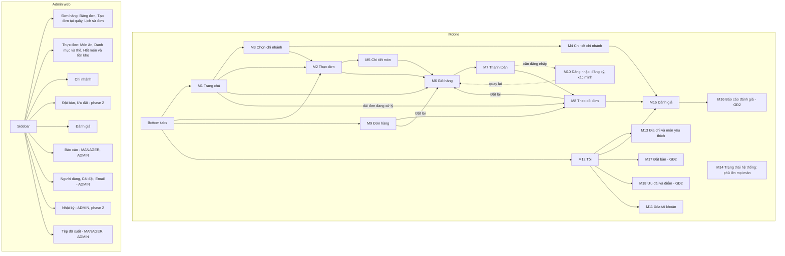

# UI design: principles, structure, screen inventory

VER.02 is the app of the owner's own restaurant ([ADR-0009](../adr/0009-owner-business-pivot.md)): one brand with branches, a menu, pickup and delivery orders (plus dine-in orders taken by staff), table reservations, loyalty and vouchers, and a staff operations console (orders board first). There is no payment inside the app: cash or bank transfer, confirmed by staff. This folder describes both surfaces: the **customer mobile app** (screen inventory M1 to M18 below, flows in [mobile.md](mobile.md)) and the **admin web** (A1 to A20, flows in [admin.md](admin.md)).

Status: **step 1 of 2 is this folder (principles, flows, inventory); step 2 is the high-fidelity HTML frames and briefs**: [designs/mobile](../../designs/mobile/brief.md) (frames 00 to 17 drawn, revision 4 of 2026-11-03: the phase 2 frames 16 and 17 are drawn and the frames got a density, icon, motion and commerce pass) and [designs/web](../../designs/web/brief.md) (31 frames). **Where a brief or a frame differs from this folder, the brief wins.** The low-fidelity wireframes of the earlier directory version are no longer kept here: they are archived as text in [designs/archive/directory-version/docs/](../../designs/archive/directory-version/README.md), and `docs/ui/mockups/mobile.html` is an early step 1 draft superseded by `designs/mobile/mockups/`.

- [Mobile flows](mobile.md)
- [Admin web flows and wireframes](admin.md)
- [Style direction and design tokens](style-direction.md)

Built on: [data-model.md](../data-model.md), [api-outline.md](../api-outline.md), [ADR-0003](../adr/0003-authentication.md), [ADR-0009](../adr/0009-owner-business-pivot.md) (ADR-0006 is superseded in part).

## Decisions from the owner (2026-10-21)

| Topic | Decision |
|---|---|
| Deliverable order | Flows and wireframes first, then mockups |
| Visual direction | Modern and commercial, photo-first, with a cool Water-element palette (ocean blue, teal, cool white; no yellow or brown, revision 2), with platform-native glass on navigation chrome. Detailed in [style-direction.md](style-direction.md) |
| Sharing | No share action is drawn in the customer app (it was a directory feature, dropped with the pivot). No public pages or universal links in the first release |
| Recent searches | Menu search keeps the last five on the device only, never on the server |
| Color modes | Light and dark, following the system setting |
| Product name | **Kitchen Daylight**, with a "KD" monogram logo (2026-10-21, replacing the working names "Nếm" and, briefly, "KD Cuisine"; the name fits the "Nắng" theme the owner asked for: daylight). `admin.md`, `mobile.md` and the frames use the new name; check for existing trademarks before launch (not done). "Foody" is not used because it is an existing brand. |
| Language | Vietnamese UI. Strings are externalised from the start so English can be added without rework. |
| Maps | Free, based on OpenStreetMap data, shown with MapLibre on web and mobile (2026-10-21). The owner first wrote "One Map"; OneMap covers Singapore only. The public OSM tile server is not for released apps, so the tile source is still open ([ADR-0005](../adr/0005-geocoding.md)) |
| Realtime | Web and mobile stay in sync in real time (requirement, 2026-10-21): orders, menu availability, branch, review, config and session events. Admin states are in [designs/web frame 19](../../designs/web/mockups/19-realtime.html), mobile states in [designs/mobile frame 15](../../designs/mobile/mockups/15-realtime.html) (14 events reach the customer app; no push in the first release, `WA3`); design in [ADR-0007](../adr/0007-realtime-sync.md), choices accepted in [ADR-0008](../adr/0008-open-items-resolution.md) (2026-10-27) |
| Export and email | List export to CSV and Excel, and system emails (invite, password reset, email verification) with a send log and editable templates (2026-10-21). Import from file, statistical reports with charts, scheduled reports, hand-written emails to staff and emails to app users were offered and **not** chosen. See [designs/web frames 20 and 21](../../designs/web/mockups/20-export.html) and [21](../../designs/web/mockups/21-email.html); for VER.02 the Excel statistics for the books are phase 1 ([frame 27](../../designs/web/mockups/27-reports.html)), and order and reservation emails are not sent in the first release (`WA3`) |
| Large lists | Never scroll hundreds of rows: paged lists (10, 20 or 50 rows), cursor paging for unbounded tables, searchable selects. See [designs/web frame 18](../../designs/web/mockups/18-data-scale.html). In the customer app every list that can grow (orders, favorites, addresses, reviews) is paged, even when the sample is short |

### Decisions of the customer app redesign (ADR-0009; accepted by the owner on 2026-10-28 and in the per-command reviews of 2026-10-30 and 2026-11-02)

The full list, with the reason for each, is in [designs/mobile/brief.md](../../designs/mobile/brief.md) ("Decisions"). The ones that shape the screens:

| Topic | Decision |
|---|---|
| Product | One brand with several branches. The customer picks a branch; the map only helps choose a branch and a delivery address. The menu is one menu with per-branch availability and price (schema), so a branch change refreshes the cart |
| Navigation | Four tabs: Trang chủ, Thực đơn, Đơn hàng, Tôi. The cart is not a tab: a floating cart bar on Home and Menu while the cart is not empty, and a cart button in the Home header (the item sheet has its own "Thêm vào giỏ" bar). The earlier Khám phá, Gần tôi and Đã lưu tabs are retired |
| Guest first | A guest browses branches and the menu and fills a cart. Sign-in is asked for at checkout and returns to the screen that opened it; a verified email is needed to place the order (`EMAIL_NOT_VERIFIED`), and a phone number at the first order (`PHONE_REQUIRED`, `WA10`) |
| Payment | None in the app: cash or bank transfer, confirmed by staff. Transfer details appear only on the customer's own unpaid `BANK_TRANSFER` order (`WA12`, `Order.transferInfo`). A paid order that is cancelled is marked `REFUNDED` by staff by hand |
| Cart | Kept on the device and validated by the server on every change (`POST /orders/quote`) and again when the order is placed (`expectedTotal`). The app never changes a cart silently: a sold-out line blocks checkout until the customer removes it |
| Order safety | Every order carries an `Idempotency-Key`. After a lost response the app says it is not sure the order was sent and sends the customer to the Orders tab |
| Order status | Shown in the app only: realtime while the app is open, refetch on resume. No push, no SMS and no order emails in the first release (`WA3`) |
| History | `view_history` is dropped (`WA11`); the Orders tab and "Đặt lại" replace it. Favorites are dishes (`favorite_items`), not venues |
| Reviews | One review per completed order, inside `review_window_days`, with a public owner reply (`WA6`). Reporting a review is phase 2 |
| Phase 2 | Table reservations (`WA8`), vouchers and points (`WA7`) carry a "GĐ2" tag in phase 1 frames and show only when the feature flag is on. Frames 16 and 17 are drawn, every board tagged GĐ2. One voucher per order, never on the delivery fee; one error message for every invalid code |
| Selling and density (2026-11-03) | Lists are dense (about twice the dishes on the first screen), rating and order count on every dish, a featured dish, suggestions in the cart, points to earn and money saved next to the total, the ready or delivery time on the order button. Phosphor icons. Attention motion only on information the customer must not miss, always off under reduced motion. Money and status never sit on a saturated gradient. The figures are sample data until the server fields exist |
| Labels | One Vietnamese label and one pill style per enum value, defined once in `00-foundations` (order, payment, branch state, item, reservation, voucher). A cancelled order is neutral, never red; red is only for errors |

## Design principles

1. **Photos lead.** Large, cropped-to-fit food images are the main visual. Every image has a blurhash placeholder (data model: `media.blurhash`) so lists never jump or flash empty.
2. **Browse without an account.** Branches, the menu, item detail and the cart work signed out. Sign-in is requested at checkout and for favorites, reviews and reports, and the user returns to what they were doing.
3. **Honest data.** Allergen and dietary labels say "chưa xác minh" until a manager verifies them; a closed, paused or past-cutoff branch is marked on the card and on the order button before the user navigates there; a sold-out or low-stock dish says so on the row.
4. **Privacy by design.** The app explains why it needs location (to sort and pick branches) before the system prompt appears and works without it. Precise location is never stored (data model). Consent checkboxes are never pre-ticked. Deleting the account is reachable in two taps from the Tôi tab.
5. **Accessible by default.** Contrast meets WCAG AA in both color modes; touch targets at least 44 x 44 pt; text scales with the system size; screen-reader labels on all icon buttons; reduced-motion respected; rating is never conveyed by color alone (a number and stars together).
6. **Vietnamese typography.** The typeface must fully support Vietnamese, and line heights leave room for stacked diacritics (for example "ế", "ặ"). Text that is user-generated must wrap, not truncate, in detail views.
7. **One pattern per concept.** One dish row and one item sheet, one branch card and one branch detail, one order card (Home ribbon, Orders tab and reorder share it), one favorites list of dishes. The order list replaces the old history list.
8. **Every screen has all its states:** loading (skeleton), empty, error, offline, and permission denied where relevant. See the state matrix below.

## Content and format conventions

| Item | Format | Example |
|---|---|---|
| Money | Integer VND with dot thousands, `đ` suffix; an item has one price, so there are no ranges. The free-delivery threshold compares with the subtotal | 65.000đ |
| Hours | 24-hour, en dash | 10:00 – 22:00; split sessions on separate lines |
| Distance | Under 1 km in meters, else km with a comma decimal | 350 m, 1,2 km |
| Rating | Comma decimal, count in parentheses | 4,5 (128) |
| Dates | `dd/MM/yyyy`; today and yesterday are written out in order lists | 27/10/2026, Hôm nay 11:44 |
| Order number | `{branchCode}-{yyMMdd}-{seq}` | BT-261027-0042 |
| Branch open state | Derived: "Đang mở · đóng cửa lúc 22:00", "Sắp ngừng nhận đơn lúc 21:30", "Đã đóng cửa · mở lại 10:00", "Tạm ngưng nhận đơn" (`TEMPORARILY_CLOSED`) | |
| Order status | One label and one pill per value (`PLACED` Chờ xác nhận, `ACCEPTED` Đã nhận, `PREPARING` Đang chuẩn bị, `READY` Sẵn sàng, `OUT_FOR_DELIVERY` Đang giao, `COMPLETED` Hoàn tất, `CANCELLED` Đã hủy, `REJECTED` Quán từ chối). Full map in frame 00 | |

## Navigation structure

Mobile uses four tabs (Trang chủ, Thực đơn, Đơn hàng, Tôi). The cart is not a tab. The selected branch is global state (`users.preferred_branch_id` when signed in, otherwise on the device), shown as a pill in the Home and Menu headers and changed from the branch sheet; changing it with a non-empty cart asks for confirmation. Guests browse and fill a cart; sign-in is asked for at checkout. VER.01's navigation drawer is dropped. The system-state screens (M14) are not a destination: they cover whatever screen is open.

## Screen inventory

Phase 1 is the first release; phase 2 follows.

### Mobile

One row per screen; the frame column is the file in [designs/mobile/mockups](../../designs/mobile/mockups/index.html). IDs M1 to M18 are unique and follow the customer's path (the shop, the order, the account, the system, then phase 2); **the "Frame bar" column shows the code printed in the frame bar of the HTML frames, which is older and where it repeats (M5, M6, M7, M9) differs from the ID here.** The brief still uses the frame-bar codes (its deviation 14). Endpoints are those of [api-outline.md](../api-outline.md) v3; the gaps the frames found in them are listed in [designs/mobile/brief.md](../../designs/mobile/brief.md) ("API and data gaps found", G1 to G121).

| ID | Screen | Frame | Frame bar | Phase | Main data and endpoints |
|---|---|---|---|---|---|
| M1 | Trang chủ: branch button with its open state, search icon, cart, active-orders ribbon, service switch, promo banner (GĐ2), reorder card, featured dish, categories, popular dishes, nearest branches | `01-home` | M1 | 1 | `GET /home`, `GET /meta/config`, `branches`, `orders`, `promotions` |
| M2 | Thực đơn: category bar, quick add, search and filter, ordering-unavailable states, live availability | `03-menu` | M2 | 1 | `GET /branches/{id}/menu`, `GET /menu/search`, `GET /tags`, `branch_menu_items` |
| M3 | Chọn chi nhánh: sheet, list and map, location priming, change branch with a non-empty cart | `02-branches` | M3 | 1 | `GET /branches` (`lat`, `lng` only as query), `users.preferred_branch_id` |
| M4 | Chi tiết chi nhánh: hours, special days, delivery zones, amenities, reviews summary, status variants | `02-branches` | M4 | 1 | `GET /branches/{id}`, `branch_opening_periods`, `delivery_zones`, `GET /branches/{id}/reviews` |
| M5 | Chi tiết món: option groups, quantity, note, sold out, low stock, favorite, allergen notice | `04-item` | M5 | 1 | `GET /menu/items/{id}`, `item_option_groups`, `PUT`/`DELETE /me/favorites/{id}` |
| M6 | Giỏ hàng: pickup or delivery, free-delivery progress, "Thêm cho đủ bữa" suggestions, quote warnings, voucher and points rows (GĐ2) with the points to earn, guest | `05-cart` | M6 | 1 | `POST /orders/quote`, `delivery_zones`, device cart |
| M7 | Thanh toán: address sheet, scheduled time, payment method, phone and email gates, every server error, success with transfer card | `06-checkout` | M7 | 1 | `POST /orders` (`Idempotency-Key`), `GET /me/addresses`, `app_settings.payment`, `Order.transferInfo` |
| M8 | Theo dõi đơn: status, timeline, cancel, payment states, courier, review prompt, live updates | `07-order-tracking` | M8 | 1 | `GET /orders/{id}`, `POST /orders/{id}/cancel`, `order_status_events`, realtime `order.*` |
| M9 | Đơn hàng (tab): in progress and history, reorder check, paging | `08-orders` | M9 | 1 | `GET /me/orders`, `POST /orders/{id}/reorder` |
| M10 | Đăng nhập, đăng ký có đồng ý, quên mật khẩu, xác minh email bằng mã 6 số | `12-auth` | M10 | 1 | `/auth/*`, `users`, `email_tokens`, `user_consents` |
| M11 | Xóa tài khoản: what is removed and kept, re-authentication, typed confirmation, blocked by active orders | `13-delete-account` | M11 | 1 | `DELETE /me`, `HAS_ACTIVE_ORDERS` |
| M12 | Tôi (tab): guest and signed in, profile card, six quick tiles (orders, addresses, favorites, reservations (GĐ2), offers (GĐ2), reviews), edit profile, devices (GĐ2), terms and privacy, change password, appearance, sign out | `11-account` | M9 | 1 | `GET /me`, `PATCH /me`, `POST /me/password`, `GET /legal/documents/current`, `GET /me/sessions` (2) |
| M13 | Địa chỉ của tôi và món yêu thích | `11-account` | M9 | 1 | `/me/addresses`, `GET /me/favorites`, `favorite_items` |
| M14 | Trạng thái hệ thống: forced update, maintenance, offline, load error, session expired, suspended, rate limited, branch paused, outside ordering hours, lost connection while ordering, cart needs update | `14-system-states` | M14 | 1 | `GET /meta/config`, `branches.status`, `429 RATE_LIMITED` |
| M15 | Đánh giá: write and edit a review of a completed order, my reviews with moderation status, all reviews of a branch with the owner reply | `09-reviews` | M5, M6 | 1 | `POST /orders/{id}/review`, `PATCH`/`DELETE /reviews/{id}`, `GET /me/reviews`, `GET /branches/{id}/reviews` |
| M16 | Báo cáo đánh giá | `10-report` | M7 | 2 (drawn now, every board tagged GĐ2) | `POST /reports`, `review_reports` |
| M17 | Đặt bàn: new reservation form (date strip, party size, time grid), slot errors, my reservations (upcoming, past), cancel, live status | `16-reservations` | M17 | 2 (every board tagged GĐ2) | `GET /branches/{id}/reservation-slots`, `POST /reservations`, `GET /me/reservations` |
| M18 | Ưu đãi và điểm: voucher wallet and code entry, points balance, rates (examples), ledger, voucher and points in the cart | `17-vouchers-points` | M18 | 2 (every board tagged GĐ2) | `GET /me/vouchers`, `GET /me/points`, `POST /vouchers/validate` |

Frames that are patterns, not screens: `00-foundations` (tokens, enum label map, components) and `15-realtime` (what each of the 14 events does on each screen; no push). Retired: the directory-version screens M2 Tìm kiếm và bộ lọc, M3 Gần tôi, M4 Chi tiết địa điểm, M8 Đã lưu / Đã xem (`view_history` dropped, `WA11`) and M12 Phiên đăng nhập as a separate screen. Search and filter now live inside the menu (M2); the map only helps choose a branch (M3).

### Admin web

One row per screen; the frame column is the file in [designs/web/mockups](../../designs/web/mockups/index.html). Roles and phases follow [admin.md](admin.md) and the brief. Endpoints marked "gap" are not in [api-outline.md](../api-outline.md) v3 yet (see "API and data gaps found" in the brief).

| ID | Screen | Frame | Phase | Main data and endpoints |
|---|---|---|---|---|
| A1 | Đăng nhập, xác thực hai bước, cài MFA, mã khôi phục, đặt mật khẩu | `01-login` | 1 | `/admin/auth/*`, `/me/mfa/*`, `users`, `mfa_credentials`, `email_tokens` |
| A2 | Bảng đơn (live board, tablet) | `02-orders-board` | 1 | `GET /admin/orders`, `/admin/orders/{id}/transition`, `/cancel`, `/payment`, `POST /admin/branches/{id}/pause`, `GET /admin/branches/{id}/recent-couriers`, `GET /admin/meta/config`, realtime `order.*` |
| A3 | Chi tiết đơn, phiếu bếp, phiếu khách | `03-order-detail` | 1 | `GET /admin/orders/{id}`, `/receipt`, `reveal-contact` (gap) |
| A4 | Lịch sử đơn | `04-orders-list` | 1 | `GET /admin/orders` (cursor, more filters: gap), `/admin/exports` |
| A5 | Tạo đơn tại quầy (tablet) | `29-counter-order` | 1 (accepted; the API lists it as 2) | `POST /admin/orders` (gap in phase 1), `orders.type = DINE_IN` (gap) |
| A6 | Phục vụ tại bàn (phone) | `30-table-order-phone` | 1 (accepted) | `POST /admin/orders/{id}/items` (gap), `orders.table_label` (gap) |
| A7 | Món ăn: danh sách và trình soạn (5 tabs) | `05-menu-items`, `06-item-editor` | 1 | `/admin/menu-items`, `/admin/branches/{id}/menu-items`, `/admin/uploads/images` |
| A8 | Danh mục và thẻ (menu categories, tags, amenities) | `07-categories-tags` | 1 | `/admin/menu-categories`, `/admin/tags` and `/admin/amenities` (gap) |
| A9 | Hết món và tồn kho (kitchen tablet) | `08-availability-stock` | 1 (history 2) | `/admin/branches/{id}/menu-items`, `.../stock`, `menu.availability_changed` |
| A10 | Chi nhánh: danh sách, trình soạn, giờ, giao hàng, ảnh và liên hệ | `09-branches`, `10-branch-editor`, `11-branch-hours`, `12-branch-delivery`, `13-branch-media-contacts` | 1 | `/admin/branches*`, `.../hours`, `.../delivery-zones` |
| A11 | Đánh giá (reports tab: phase 2, drawn) | `14-reviews` | 1 (reports tab 2) | `/admin/reviews`, `/status`, `/reply`; `/admin/reports` (2) |
| A12 | Người dùng: nhân viên và khách hàng | `15-users` | 1 | `/admin/users*`, `mfa-reset`, `resend-invite` |
| A13 | Tổng quan hôm nay | `16-dashboard` | 1 | `GET /admin/dashboard` (gap) |
| A14 | Nhật ký hoạt động (ADMIN) | `17-audit-log` | 2 (rows written from 1) | `GET /admin/audit-logs` |
| A15 | Xuất dữ liệu và Tệp đã xuất | `20-export` | 1 | `/admin/exports*`, `export_jobs` |
| A16 | Email hệ thống: lịch sử gửi và mẫu thư (ADMIN) | `21-email` | 1 | `/admin/email-messages`, `/admin/email-templates`, `email_suppressions` |
| A17 | Cài đặt (ADMIN, eight sections) | `22-settings` | 1 (loyalty section: 2) | `/admin/app-settings`, `GET /admin/meta/config` |
| A18 | Thống kê: Excel for the books (part A, phase 1) and charts (part B, phase 3: revenue, top items, orders overview, peak hours, each with a table under it) | `27-reports` | 1 (charts 3) | `POST /admin/exports` (`REVENUE`), `GET /admin/reports/revenue`, `/top-items`, `/orders-summary` (response shapes and `compare`: gap) |
| A19 | Đặt bàn: lịch và bàn | `23-reservations`, `24-tables` | 2 | `/admin/reservations*`, `/admin/branches/{id}/tables` |
| A20 | Ưu đãi: voucher, banner, điểm thưởng | `25-vouchers`, `26-promotions-loyalty` | 2 | `/admin/vouchers*`, `/admin/promotions`, `/admin/settings/loyalty` |

Frames that are patterns, not screens: `00-foundations` (tokens, shell, roles, components), `18-data-scale` (big lists and paging), `19-realtime` (connection and conflicts). Deferred, with no screen ID: `28-invoices` (e-invoices, `WA17`). Frame 28 is drawn (queue, record and issue, detail, settings section 9, customer app additions) but marked `Chưa bật`: it is used only if the owner enables e-invoices. Frames 14 (reports tab, phase 2), 23 to 26 (phase 2) and 27 (charts, phase 3) are all drawn.

## State matrix

This is the mobile matrix. The admin web states (loading, empty, error, conflict, denied) are drawn per frame and listed in [admin.md](admin.md) and the web brief. Every mobile frame also has a `Quyền` row and an `Lỗi` row in its "Dữ liệu" table; every error code the API outline gives a screen has a drawn state. Drawn state boards are listed in the frame index of [designs/mobile/brief.md](../../designs/mobile/brief.md).

| Screen | Loading | Empty | Error / offline | Permission, auth or business state |
|---|---|---|---|---|
| M1 | Skeleton for each block | The reorder card and the active-orders ribbon are simply absent; the "Món chính" tile may be empty (G28) | Full-screen retry on a load error; offline shows saved data with a pinned banner and locks "Đặt lại" | Guest: no ribbon, no reorder. No location: branches without distances (the default order is an open gap, G8). Branch closed or `TEMPORARILY_CLOSED`: status strip and every "+" locked |
| M2 | Category and row skeletons | "Thực đơn trống" with "Chọn chi nhánh khác" for a branch with no items (a single empty category is never returned); "Không tìm thấy" with a clear-filters action after a search or filter | Retry; offline shows the saved menu | Branch closed, paused, past the order cutoff, or delivery not open yet: the menu stays readable, ordering is locked with the reason. An item that sells out while open updates in place |
| M3 | List skeleton, map without tiles | n/a (a chain always has a branch) | Retry; offline; map without tiles keeps the list | Location denied: explanation first, then the system prompt; works without it. Changing branch with a non-empty cart asks to refresh the cart |
| M4 | Image blurhash, text skeleton | "Chưa có ảnh" | Retry; "Chi nhánh không còn hoạt động" for a removed branch | Status variants: paused, closed, special schedule, delivery not open yet |
| M5 | Image blurhash, text skeleton | n/a | Retry; item no longer on the menu; offline | Sold out: add locked. Low stock: quantity capped. Required option group missing or `OPTION_INVALID`: inline, add locked. Guest: favorite asks for sign-in |
| M6 | "Đang tính…" while a quote runs | Empty cart with a button to the menu | Quote error and offline keep the last quote and block checkout; cart full (`maxCartLines`) | Quote warnings (sold out, price changed, stock low, option invalid, branch closed) block checkout until the customer fixes the line. Guest: checkout asks for sign-in. Out of delivery zone or below the minimum: shown before checkout |
| M7 | "Đang đặt hàng" locks the screen | n/a | Every code has a state: `PRICE_CHANGED`, `ITEM_UNAVAILABLE`, `BRANCH_CLOSED`, `BELOW_MIN_ORDER`, `OUT_OF_ZONE`, `OPTION_INVALID`, `VOUCHER_INVALID`, `INSUFFICIENT_POINTS`, `RATE_LIMITED`, `MAINTENANCE`, `UPGRADE_REQUIRED`, `INTERNAL_ERROR`. Lost connection: "not sure the order was sent", go to the Orders tab, retry reuses the `Idempotency-Key` | `PHONE_REQUIRED` and `EMAIL_NOT_VERIFIED` gates; session or account errors; bank transfer locked while the bank details are missing (the flag `payment.bankTransferEnabled` is a proposal, G49); success shows the transfer card only for the customer's own unpaid `BANK_TRANSFER` order |
| M8 | Skeleton | n/a | Retry; not found; offline shows the last loaded order; no ETA yet | One screen per status (8). Cancel only while `PLACED` (`ORDER_NOT_CANCELLABLE` otherwise). Payment pills include `REFUNDED` and "Đã thanh toán · quán sẽ liên hệ hoàn tiền". Call hint after `callHintMinutes` unaccepted. Review prompt only when `canReview` |
| M9 | Card skeletons | "Chưa có đơn hàng" per tab | Retry; offline shows saved lists; infinite scroll with a pager | Guest: sign-in prompt. Reorder check lists lines that are gone, changed in price or invalid in options |
| M10 | Button spinner | n/a | `VALIDATION_FAILED` under the fields, `RATE_LIMITED` with a countdown, network loss | Generic messages that never reveal whether an email exists; `ACCOUNT_SUSPENDED`; lockout shows a time-based message without detail; consent unticked keeps "Đăng ký" disabled |
| M11 | "Đang xóa" | n/a | A network error keeps the account untouched | `HAS_ACTIVE_ORDERS` (orders, and upcoming reservations in phase 2) blocks it; re-authentication and the typed word "XÓA" are required |
| M12 | Skeleton | "Chưa có số điện thoại" | Retry; offline | Guest and signed-in variants; unverified email banner with "Xác minh email" (opens the 6-digit code entry) |
| M13 | Row skeletons | "Chưa có địa chỉ", "Chưa có món yêu thích" | Retry; offline; undo after a swipe delete | A removed dish ("Món không còn trong thực đơn") and a sold-out dish keep their row; guest: sign-in prompt |
| M14 | n/a | n/a | These are the error screens: forced update, maintenance, no connection, load error | Session expired, account suspended, rate limited, branch paused, outside ordering hours, cart needs update |
| M15 | Submit spinner | "Chưa có đánh giá" | Keep the text and show the error inline; retry | Guest: sign in first and return. Unverified email: verify first. `ORDER_NOT_REVIEWABLE` (not completed, past the window, not yours). Own review shows `PUBLISHED`, `HIDDEN` or `REMOVED` |
| M16 (2) | Submit spinner | n/a | Inline error; already reported (`DUPLICATE_REPORT`) | Guest: sign in first. The entry is hidden on the customer's own review |
| M17 (2) | Frames in the shape of the cards | "Chưa có đặt bàn sắp tới" and "Chưa có đặt bàn nào trước đây" | Retry; offline shows saved reservations and locks "Đặt bàn mới" and "Hủy" | Guest: sign-in prompt, the form is readable. `SLOT_UNAVAILABLE` with the nearest slots, `VALIDATION_FAILED`, `RATE_LIMITED`, session expired, cancel `INVALID_TRANSITION`; live `reservation.status_changed` |
| M18 (2) | Voucher-shaped and ledger-shaped skeletons | "Chưa có voucher nào"; balance 0 with "Chưa có giao dịch điểm" | Retry; offline shows saved vouchers and points and locks code entry | Guest: sign-in prompt, no code field. `VOUCHER_INVALID` has **one** message for every cause ("Mã không dùng được"); `RATE_LIMITED`, network loss, `INTERNAL_ERROR`, session expired; loyalty switched off keeps the ledger readable |

## Gaps this design revealed in the API

The customer app of the restaurant adds its own gaps: fields, parameters and error details the mobile frames need that [data-model.md](../data-model.md) v5 and [api-outline.md](../api-outline.md) v3 do not state (for example `activeOrders` in `GET /home`, `hasRequiredOptions` on menu items, an address-less quote with a "from" delivery fee, `payment.bankTransferEnabled`, the response of `POST /orders/{id}/reorder`, `GET /me/orders?scope=`, `email` and `emailVerifiedAt` in `GET /me`). They are the 121 numbered rows G1 to G121 of [designs/mobile/brief.md](../../designs/mobile/brief.md), "API and data gaps found". **Unlike the admin gaps below, they have not been folded into the data model or the API outline yet:** every row is still a proposal, and the owner and the engineers have to confirm them first.

The restaurant admin console adds its own gaps (columns and endpoints the frames need and data model v5 and api-outline v3 did not have, for example `DINE_IN`, `orders.table_label`, `POST /admin/orders/{id}/items`, `GET /admin/dashboard`, `GET /admin/reports/revenue` in phase 1, `reveal-contact`): the full list of 328 gaps is in [designs/web/brief.md](../../designs/web/brief.md), "API and data gaps found". On 2026-10-30 they were folded into [data-model.md](../data-model.md) and [api-outline.md](../api-outline.md) as proposals, each tagged `(brief ID)`; [designs/web/gaps-coverage.md](../../designs/web/gaps-coverage.md) says where each one went.

## Open items

1. **Map tile source** (library decided: MapLibre with OpenStreetMap data; hosting and cost open, ADR-0005) affects M3, M4 and the "Chỉ đường" action.
2. **Product name and trademark.** Kitchen Daylight with the "KD" monogram is in use; the trademark search is not done. The palette and tokens are in [style-direction.md](style-direction.md); the owner has not confirmed them as final.
3. **Photography.** Placeholder images are used in the frames; the real dishes and branches need the owner's photos and image rights.
4. **Real restaurant data.** Branches, hours, delivery zones and fees, the menu with prices, the bank details for transfers (`app_settings.payment`: without them the first release is cash only) and the hotline per branch (`WA1`, `WA2`, `WA12`; [../README.md](../README.md), "Open").
5. **Menu per branch.** The frames follow the schema (one menu, per-branch availability and price, so a branch change refreshes the cart). If the owner means really separate menus, M2, M5 and M6 change (brief, open question 1).
6. **Customer app gaps G1 to G121** wait for the owner's and the engineers' confirmation before they go into the data model and the API outline (see above).
7. **Phase 2 frames.** M17 Đặt bàn and M18 Ưu đãi và điểm are drawn (revision 4 of the brief). Open: a date picker beyond the 14-day strip, an email gate before reserving, the delivery-fee wording of the web voucher `GIAO15`, who chooses the featured and suggested dishes, and the server fields behind ratings, order counts and points to earn (brief gaps G122 to G146 and questions 20 to 22).
8. **Screen codes.** The IDs M1 to M18 in this file are unique; the frame bars and the brief of the mobile frames still carry the older codes that repeat (M5, M6, M7 and M9 are each used twice). Renumbering them is a follow-up.

The two directory-era open items (whether cafés are in scope, and the "chưa xác minh" source label for imported places) are void: the venue types and the open-data import were dropped with the pivot ([ADR-0009](../adr/0009-owner-business-pivot.md), [ADR-0008](../adr/0008-open-items-resolution.md) items 3 and 14 are void).
