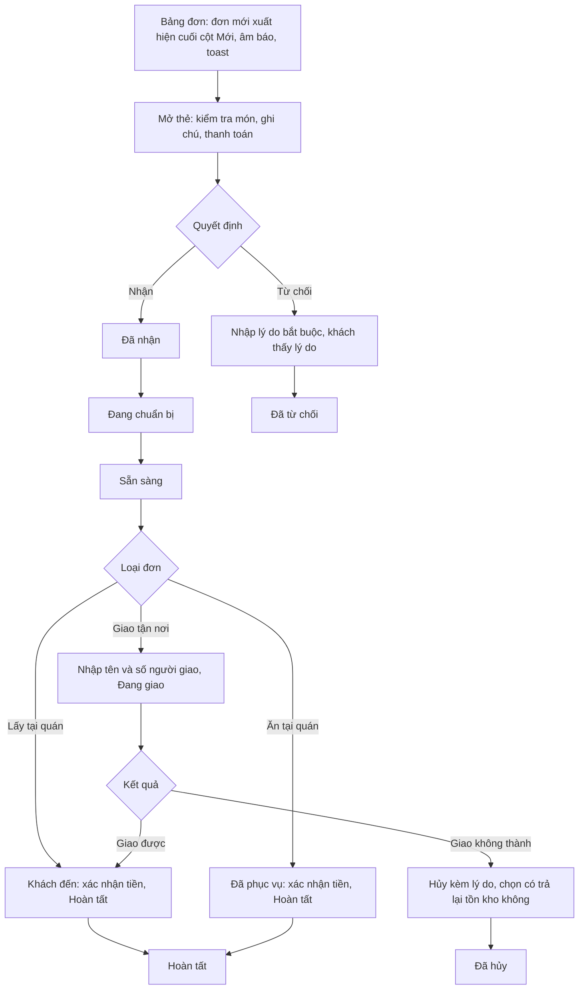
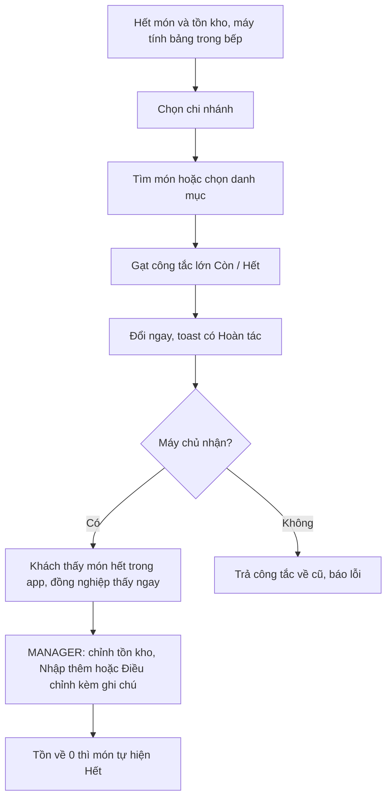
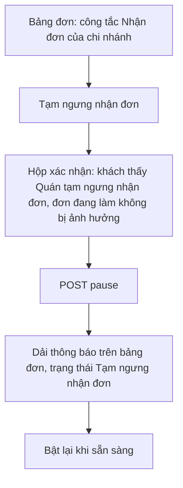
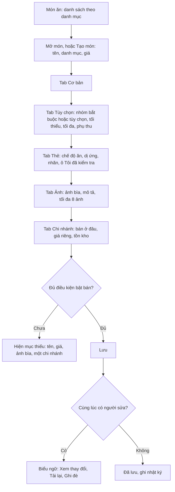
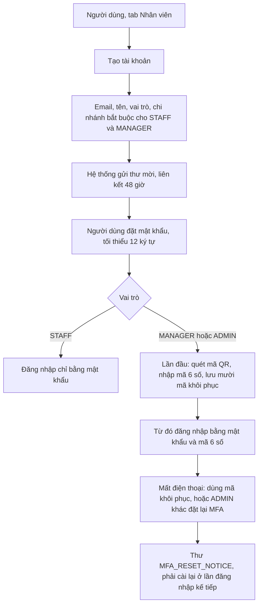
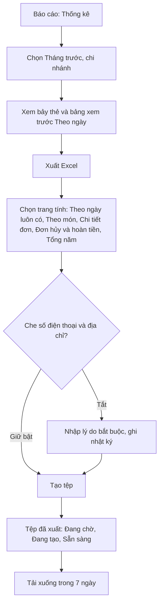
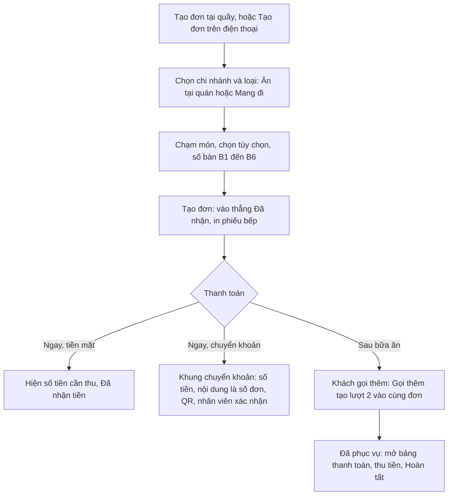

# Admin web: flows and wireframes

Status: draft for review, **redrawn on 2026-10-29 for the owner's restaurant** ([ADR-0009](../adr/0009-owner-business-pivot.md)). The admin web is the operations console of one restaurant with several branches: a live orders board first, then menu and stock, branches, reviews, staff, the Excel statistics for the books, and later reservations, vouchers and charts. The high-fidelity design is [designs/web/brief.md](../../designs/web/brief.md) (frames 00 to 30; the screen-to-frame table is in [README.md](README.md)); **where it differs from the wireframes below, the brief wins.** Sample names are fictional (`docs/tmp/web-design/02-sample-data.md` while that folder exists). Context and conventions are in [README.md](README.md). The endpoints are in [api-outline.md](../api-outline.md) v3 and the tables in [data-model.md](../data-model.md) v5; **columns and endpoints the design needs and the documents do not have yet are listed in the brief** ("API and data gaps found").

Desktop-first (1024 px and wider) and usable on a tablet. Three screens are built for touch with targets of at least 48 px: the orders board, the availability screen and the counter order screen (tablet at the counter and in the kitchen). One screen is drawn at phone width (360 to 430 px): table service at the table. Component library: Angular with PrimeNG (ADR-0001). Labels are Vietnamese.

Roles: `STAFF` run the day (orders, availability, pause, counter orders); `MANAGER` also manage the menu, stock, branches, reviews and see revenue and statistics for their branches; `ADMIN` additionally manage users, settings, email templates and the audit log and see every branch. Staff and managers see **only their branches**; an `ADMIN` also gets `Tất cả chi nhánh`. `MANAGER` and `ADMIN` sign in with a password **and** a TOTP code (ADR-0009). Revenue figures, the statistics page and every export are hidden from `STAFF`. The server enforces all of this; the UI only hides what the role cannot do: a control the role cannot use is not rendered, a page it cannot use shows `Bạn không có quyền xem trang này`, and a record outside its branches shows `Không tìm thấy`.

Legend: `[ ]` button, `( )` chip or radio, `[x]` checkbox, `▾` dropdown, `▭` image.

## Navigation

```
┌───────────────┬──────────────────────────────────────────────────┐
│ KD · Quản trị │ [Chi nhánh ▾]    ● Đang kết nối · 12:05:41  Trần M ▾ (ADMIN)
├───────────────┼──────────────────────────────────────────────────┤
│ Tổng quan     │                                                  │
│ Đơn hàng  (4) │                                                  │
│  · Bảng đơn   │                                                  │
│  · Tạo đơn tại│                (nội dung trang)                  │
│    quầy       │                                                  │
│  · Lịch sử đơn│                                                  │
│ Thực đơn      │                                                  │
│  · Món ăn     │                                                  │
│  · Danh mục   │                                                  │
│    và thẻ     │                                                  │
│  · Hết món và │                                                  │
│    tồn kho    │                                                  │
│ Chi nhánh     │                                                  │
│ Đặt bàn *     │                                                  │
│ Ưu đãi *      │                                                  │
│ Đánh giá (1)  │                                                  │
│ Báo cáo       │                                                  │
│ ─────────     │                                                  │
│ Người dùng ‡  │                                                  │
│ Cài đặt ‡     │                                                  │
│ Email ‡       │                                                  │
│ Nhật ký ‡ *   │                                                  │
│ Tệp đã xuất § │                                                  │
└───────────────┴──────────────────────────────────────────────────┘
 *  phase 2     ‡  ADMIN only     §  MANAGER and ADMIN
```

The count next to `Đơn hàng` is the number of new orders in the selected branches; next to `Đánh giá` it is the number of open reports (phase 2). Items a role cannot use are not rendered: `STAFF` see no `Báo cáo`, no `Tệp đã xuất` and no `Xuất` button on any list. The branch switcher lists only the user's branches (a single-branch user sees the branch name as a label). The dot shows the realtime connection (`Đang kết nối`, `Đang thử lại`, `Mất kết nối`) and `Cập nhật lúc` is the last time data arrived. On a phone the same console shows a bottom bar: `Bảng đơn`, `Tạo đơn`, `Bàn đang mở`, `Khác`.

## Flows

### AF1. Process an order



Each card shows the order number, the type, the customer's given name with a masked phone, the time in the current status (warning, then `Trễ`), the items, the total and the payment chip. Every column is sorted oldest first. Status changes are **never optimistic**: the card moves only after the server answers, and a `409 STALE_VERSION` (another person got there first) reloads the order and says who, in neutral wording. An order can be completed only when paid (`PAYMENT_NOT_CONFIRMED`): cash or transfer is confirmed in the payment panel (`Đã nhận tiền`), which writes an audit row; for a bank transfer a person checks the banking app, there is no bank connection. A paid order that is cancelled or rejected keeps the chip `Cần hoàn tiền` until staff pay back by hand and mark `REFUNDED`. Customer contact is masked; revealing it writes an audit row.

### AF2. Update availability



Availability is the one place where the screen changes first and confirms after (undo toast), because a tap in the kitchen must be instant; every other write waits for the server. `STAFF` only have the switch; `MANAGER` and `ADMIN` also have the stock stepper and the restock and adjust dialogs. A colleague's change arrives live (`menu.availability_changed`) and the screen shows who made it. Offline, the switches lock. A low-stock warning (`Sắp hết`) appears under the item's threshold.

### AF3. Pause orders



Any role may pause or resume a branch (a switch of `branches.status` between `ACTIVE` and `TEMPORARILY_CLOSED`, never `CLOSED`). With several branches selected the board asks which branch. Orders already in progress continue. Whether staff may still take counter orders while the branch is paused is an open question (see the brief).

### AF4. Edit a menu item



Only `MANAGER` and `ADMIN` edit the menu (a manager's price and stock overrides apply to their branches). A tag for an allergen or a diet stays `Chưa xác minh` in the app until someone ticks `Tôi đã kiểm tra thông tin này`. A selling item needs a Vietnamese name, a price above zero, a cover photo and at least one branch. Deleting an item is soft and the dialog states the branches and open orders that use it; old orders keep their own snapshot.

### AF5. Create a staff account with MFA (ADMIN)



Guards: an admin cannot demote, disable or reset the MFA of themselves (`SELF_CHANGE`), and the last active `ADMIN` cannot be demoted or disabled (`LAST_ADMIN`); the screen advises keeping two admins with MFA. A role change ends the person's sessions. If the invitation mail fails or bounces, the account stays `Đã mời` and the email log shows why; `Gửi lại lời mời` issues a new link and voids the old one. There is no email or SMS bypass of the second factor.

### AF6. Export the monthly statistics (MANAGER, ADMIN)



The figures count completed orders only, by business day (starts at 04:00 by default, Vietnam time). The same dialog logic applies to every list export (items, orders, reviews, stock): the file follows the filters on screen, contact is masked by default and the reason is mandatory to unmask. `MANAGER` export only their own branches and only their own files; users and the audit log are `ADMIN` only. Charts for the same page are phase 3.

### AF7. Take an order at the counter or at the table



The kitchen starts at once, also while a transfer is unconfirmed. The customer is optional (`Khách tại quầy`). Delivery is not offered at the counter. Adding items is allowed only while the order is unpaid and not final.

## Wireframes

The wireframes show structure only; the frames in the brief are the design.

### A1. Đăng nhập

```
┌────────────────────────────────────────┐
│      Kitchen Daylight · Quản trị       │
│                                        │
│  Email                                 │
│  ┌──────────────────────────────────┐  │
│  └──────────────────────────────────┘  │
│  Mật khẩu                              │
│  ┌──────────────────────────────────┐  │
│  └──────────────────────────────────┘  │
│  [            Đăng nhập            ]   │
│  Quên mật khẩu                         │
│                                        │
│  Bước 2 (Quản lý, Quản trị viên):      │
│  ┌──┐┌──┐┌──┐┌──┐┌──┐┌──┐  mã 6 số    │
│  └──┘└──┘└──┘└──┘└──┘└──┘             │
│  Dùng mã khôi phục · Mất điện thoại?   │
└────────────────────────────────────────┘
```

A wrong email or password shows one generic message that reveals nothing; a temporary lock shows `Thử lại sau ít phút` without the unlock time. Staff accounts have no social login. Maintenance never blocks staff sign-in.

### A2. Bảng đơn

```
┌──────────────────────────────────────────────────────────────────────────┐
│ Bảng đơn   [Chi nhánh: Bến Thành ▾]   [Nhận đơn ●]   [Bảng | Danh sách]  │
├──────────────┬──────────────┬──────────────┬──────────────┬──────────────┤
│ Mới (3)      │ Đã nhận (2)  │ Chuẩn bị (2) │ Sẵn sàng (3) │ Đang giao (1)│
├──────────────┼──────────────┼──────────────┼──────────────┼──────────────┤
│ BT-…-0043    │ BT-…-0038    │ BT-…-0035    │ BT-…-0036    │ BT-…-0034    │
│ Giao · Bảo   │ Lấy · Hạnh   │ Lấy · An     │ Lấy · Yến    │ Giao · Quang │
│ 14 ph · Trễ  │ Hẹn 12:30    │ 25 ph · Trễ  │ 8 ph         │ 15 ph        │
│ 184.000đ     │ 114.000đ     │ 158.000đ     │ 105.000đ     │ 218.000đ     │
│ CK chưa trả  │ Tiền mặt     │ Tiền mặt     │ Tiền mặt     │ Tiền mặt     │
│ [Nhận][Từ    │ [Bắt đầu]    │ [Sẵn sàng]   │ [Giao hàng]  │ [Hoàn tất]   │
│  chối][⋯]    │              │              │              │              │
├──────────────┴──────────────┴──────────────┴──────────────┴──────────────┤
│ Đã hủy / từ chối hôm nay · 2        Hoàn tất hôm nay · 23  (dải thu gọn)  │
└──────────────────────────────────────────────────────────────────────────┘
 Giao = giao tận nơi · Lấy = lấy tại quán · ph = phút · CK = chuyển khoản
```

Oldest first in every column; a new order lands at the bottom of `Mới` with a ring, a toast, a sound and, when it is off-screen, a `Có N đơn mới ↓` button. A card turns warning then `Trễ` by the time in its status (placeholder thresholds in settings). Scheduled orders are not counted late. Tap a card for the detail panel (A3). All buttons are at least 48 px.

### A9. Hết món và tồn kho

```
┌──────────────────────────────────────────────────────────────────────┐
│ Hết món và tồn kho     [Chi nhánh: Bến Thành ▾]   Tìm món…            │
│ (Tất cả)(Cơm)(Bún và phở)(Món chay)(Ăn vặt)(Đồ uống)(Tráng miệng)     │
├──────────────────────────────────────────────┬───────────────────────┤
│ Cơm sườn nướng            Sắp hết · Còn 3     │  [ Còn  ◉━━ ]  (lớn)  │
│ Bánh flan                 Hết                 │  [ Hết  ━━◉ ]         │
│ Cơm gà nướng mật ong      Còn                 │  [ Còn  ◉━━ ]         │
│ …                                             │                       │
├──────────────────────────────────────────────┴───────────────────────┤
│ MANAGER: tồn kho  [−] 3 [+]   [Nhập thêm] [Điều chỉnh]                │
└──────────────────────────────────────────────────────────────────────┘
```

### A12. Người dùng (ADMIN)

```
┌──────────────────────────────────────────────────────────────────────┐
│ Người dùng   [ Nhân viên | Khách hàng ]            [ + Tạo tài khoản ]│
│ Tìm theo tên hoặc email…   Vai trò ▾  Chi nhánh ▾  Trạng thái ▾        │
├──────────────────┬──────────┬────────┬──────────┬───────────┬────────┤
│ Tên và email     │ Vai trò  │ Chi nhánh│ Xác thực │ Trạng thái │        │
├──────────────────┼──────────┼────────┼──────────┼───────────┼────────┤
│ Trần Minh        │ Quản trị │ Tất cả │ Đã bật   │ Hoạt động  │ [Sửa]  │
│ Nguyễn Phúc      │ Quản lý  │ BT     │ Đã bật   │ Hoạt động  │ [Sửa]  │
│ Phan Lộc         │ Nhân viên│ BT     │ Không yêu│ Đã mời     │ Gửi lại│
│                  │          │        │  cầu     │            │ lời mời│
└──────────────────┴──────────┴────────┴──────────┴───────────┴────────┘
```

The list shows no password data, token or device. The `Khách hàng` tab shows masked email and phone, the number of orders and the last order; revealing contact writes an audit row. Customers who deleted their account appear as `Người dùng đã xóa`.

### Other screens (structure only)

- **A3 Chi tiết đơn:** a 520 px side panel (or a full page) with the customer (masked), items with options and notes, allergen warnings, totals (`Tạm tính`, `Phí giao hàng`, `Tổng cộng`), payment state and actions, the status timeline, and the kitchen ticket and customer receipt (58 and 80 mm) as print previews.
- **A4 Lịch sử đơn:** filters by branch, status, type, source, payment and a mandatory date range, quick filters (`Chưa thanh toán`, `Cần hoàn tiền`, `Đã hủy hôm nay`, `Đơn trễ`), search by order number, phone or table, newer/older cursor paging and an estimated count; no total row for `STAFF`.
- **A5 Tạo đơn tại quầy and A6 Phục vụ tại bàn:** a menu grid with a cart, table chips and a payment panel (see AF7); on the phone, a bottom sheet cart and a list of open tables.
- **A7 Món ăn:** list grouped by category, filters, row menu, drag to reorder; the item editor has five tabs (see AF4).
- **A8 Danh mục và thẻ:** three tables with a side form: menu categories, tags (diet, allergen, label) and branch amenities; deleting something in use is refused with the count and a link to the filtered list.
- **A10 Chi nhánh:** the list (pause switch, add, delete with a typed code) and the editor tabs: info and address (map pin, location confirmation), opening hours and special days, delivery rings with an address check tool, photos, amenities and contact.
- **A11 Đánh giá:** reviews of completed orders with the owner's reply, hide, remove and restore (a required note each); the reports tab (phase 2) is the moderation queue of reports about reviews.
- **A13 Tổng quan:** today's operations: six cards, the last 7 days, a branch comparison (admin), the needs-attention groups; revenue is hidden from `STAFF`.
- **A14 Nhật ký (phase 2):** read-only append-only log with a before and after view, filters and a mandatory date range; kept 24 months.
- **A15 Xuất dữ liệu và Tệp đã xuất:** the export button and dialog on lists, nine file types, job states and the files screen (7 days).
- **A16 Email hệ thống (ADMIN):** the send log with bounce and complaint handling and five editable templates (staff invitation, staff password reset, email-verification code, password-reset code, MFA reset notice) with a preview and a test send. **Order and reservation emails are not sent in the first release.**
- **A17 Cài đặt (ADMIN):** eight sections: brand and receipt, ordering, payment, business day, maintenance and version, features, loyalty (phase 2), security (read-only). A ninth section, `Thuế và hóa đơn`, exists only if e-invoices are enabled (frame 28).
- **A18 Thống kê:** the Excel statistics page (see AF6); in phase 3 the same page gets three tabs with charts, each with a table underneath: revenue (by day, branch, order type or payment method, optional comparison with the previous period), top items (quantity and revenue), and an orders overview (status counts, cancellations by reason, average times, a peak-hours grid by weekday).
- **A19 Đặt bàn (phase 2):** the day calendar of reservations by table with the queue of requests waiting for confirmation, and the tables with their reservation rules (seats, party size, lead time, days ahead).
- **A20 Ưu đãi (phase 2):** vouchers (list, editor, assign to customers, redemptions), home banners with a phone preview, and loyalty points (rates read from settings, the customer ledger, a manual adjustment that needs a note and is `ADMIN` only).
- **Patterns, not screens:** foundations, shell, roles and components (frame 00); big lists and paging (18); realtime behaviour (19).
- **Deferred:** e-invoices (frame 28, drawn and marked `Chưa bật`: a queue with the tabs `Cần xuất`, `Đã xuất`, `Lỗi` and `Đã hủy`, recording or issuing an invoice, cancel and replace, a daily summary invoice, the invoice block of an order, settings section 9, and an optional checkout section and an invoice line in the customer app); the receipt is a printed sale receipt and the Excel statistics replace the e-invoice in the first release (`WA17`).

## Admin states

| Screen | Loading | Empty | Error |
|---|---|---|---|
| Lists | Table skeleton | "Chưa có dữ liệu" or "Không có kết quả khớp bộ lọc" with a clear-filters action | Inline retry; keep filters and the date range |
| Orders board | Column skeletons on first load | "Chưa có đơn đang xử lý" | Connection bar (`Đang thử lại`, `Mất kết nối` after 30 s with no data); a failed action keeps the card in place with a retry; session expiry keeps the unsent action |
| Forms | Disabled save while submitting | n/a | Field-level messages from `errors[]`; unsaved-changes guard; `STALE_VERSION` banner with `Xem thay đổi`, `Tải lại`, `Ghi đè` |
| Map pin | Spinner on the map | "Chưa đặt vị trí" | Manual pin always available; location confirmation required before a branch can be active |
| Session | n/a | n/a | Expired access token: silent refresh; a failed refresh returns to login and keeps the unsent form in memory where possible; a role change returns `FORBIDDEN` and the page shows the denied-access page |
| Role | n/a | n/a | Page not allowed: `Bạn không có quyền xem trang này`; record outside the user's branches: `Không tìm thấy` |

## Not covered

Bulk actions, import from a file, keyboard shortcuts, a profile or change-password screen for staff (MFA enrolment and recovery codes are drawn in the login frame), courier accounts (the courier is a typed name), kitchen-display and several-printer screens, split bills, moving an order between tables, expenses and profit (there is no such data), and the phase 2 and 3 screens listed above until their frames are drawn. List export, system email and the Excel statistics are described in the flows above and drawn in step 2 ([designs/web](../../designs/web/brief.md)).
