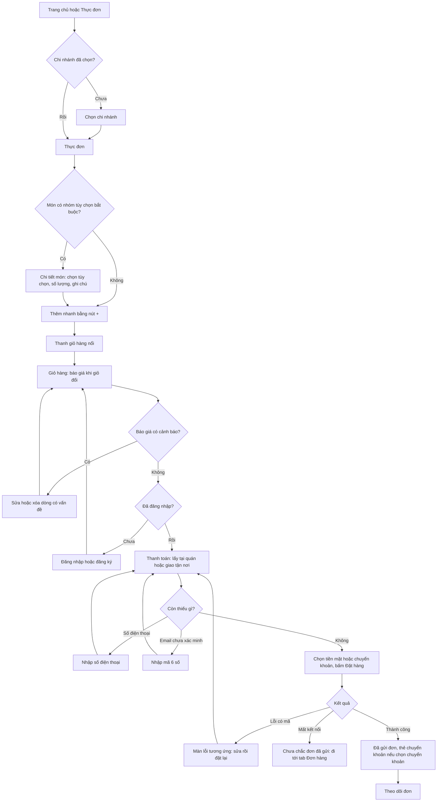
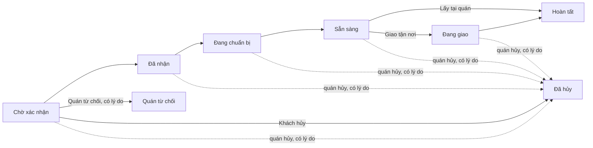
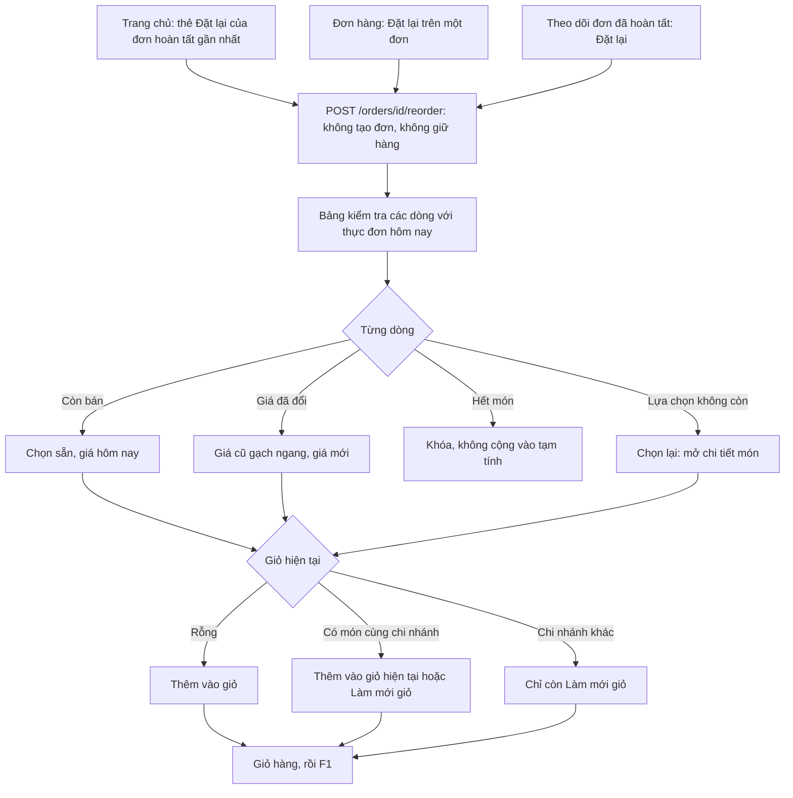
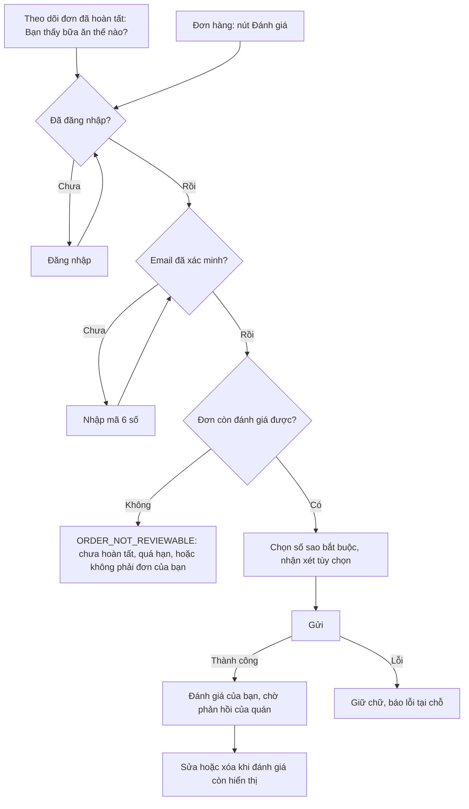
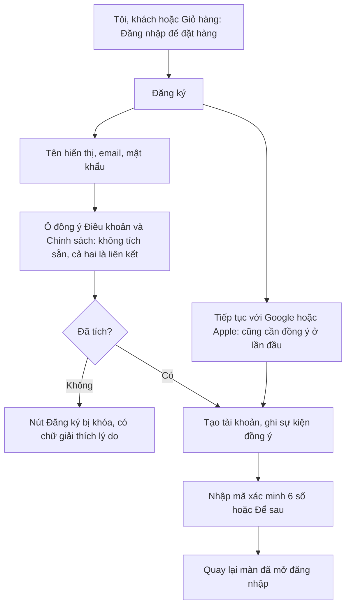
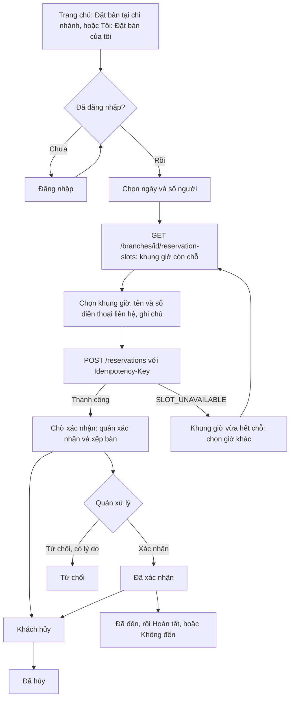
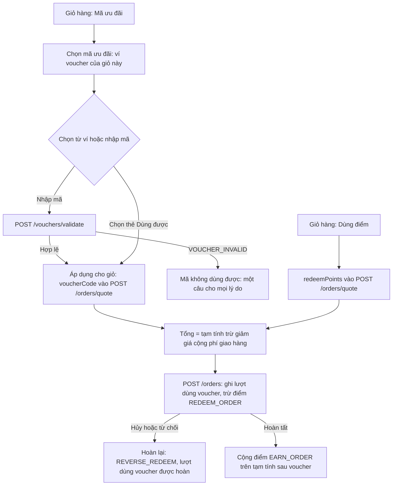
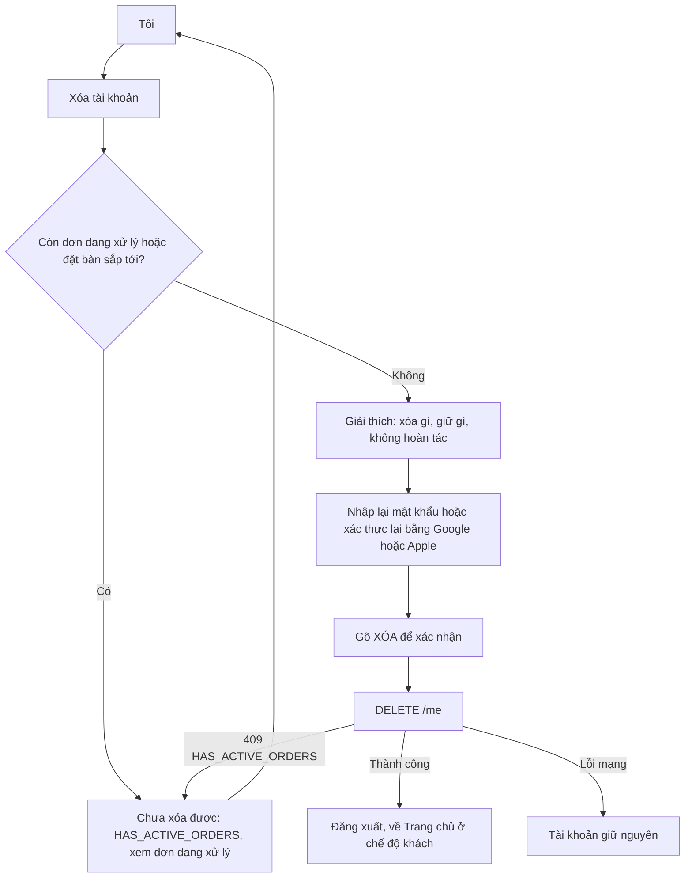
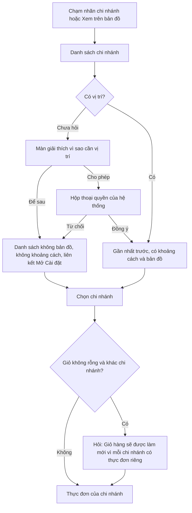
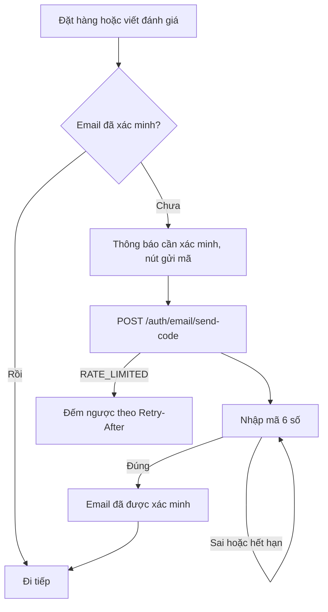

# Mobile: flows

Status: **rewritten on 2026-11-02 for the owner's restaurant** ([ADR-0009](../adr/0009-owner-business-pivot.md)); it replaces the directory-version flows and wireframes (the old file is kept as text in [designs/archive/directory-version/docs/ui-mobile.md.txt](../../designs/archive/directory-version/docs/ui-mobile.md.txt)). The customer app lets a guest browse branches and the menu and fill a cart, and a signed-in customer with a verified email order for pickup or delivery, follow the order, reorder, review a completed order, and (phase 2) book a table and use vouchers and points. **There is no payment in the app**: cash or bank transfer, confirmed by staff.

The screens are drawn as high-fidelity frames, so the low-fidelity wireframes that used to sit here are gone: a flow below names the screen IDs (M1 to M18) and the frames to look at. The inventory of screens, the navigation diagram, the state matrix and the decisions are in [README.md](README.md); the full design, the sample data, the deviations from the documents and the API and data gaps are in [designs/mobile/brief.md](../../designs/mobile/brief.md); the frames are indexed in [designs/mobile/mockups/index.html](../../designs/mobile/mockups/index.html). **Where the brief or a frame differs from a flow here, the brief and the frame win.**

Flows use the API names of [api-outline.md](../api-outline.md) v3. The label of every status and state is in frame `00-foundations`. Screen text is Vietnamese; node labels below follow it.

## Rules that every flow relies on

| Rule | Detail |
|---|---|
| Guest | Branches, branch detail, the menu, item detail and the cart work signed out. The cart lives on the device |
| Sign-in gate | Asked for at **checkout** (the cart button reads "Đăng nhập để đặt hàng"), and for favorites, reviews and reports. After signing in, the app returns to the screen that opened the sign-in: the cart, or checkout when the session expired there |
| Email gate | A verified email is needed to place an order and to write a review (`EMAIL_NOT_VERIFIED`): a 6-digit code typed in the app, no link (`WA10`) |
| Phone gate | The phone number is asked at the first order (`PHONE_REQUIRED`) and is not verified in the first release |
| Branch | One global selected branch (`users.preferred_branch_id`, or on the device). Changing it with a non-empty cart asks for confirmation and refreshes the cart, because lines and prices are per branch |
| Order status | Shown in the app only: realtime while it is open, refetch on resume. No push, no SMS, no order emails (`WA3`) |
| Phase 2 | Reservations, vouchers and points appear only when the feature flag is on and carry a "GĐ2" tag |

## Flows

### F1. Order (guest to a placed order, to a finished one)

Screens: M1 Trang chủ, M2 Thực đơn, M3 Chọn chi nhánh, M5 Chi tiết món, M6 Giỏ hàng, M10 Đăng nhập, M7 Thanh toán, M8 Theo dõi đơn. Frames: `01-home` to `07-order-tracking`, `12-auth`.

What each step does:

- **Cart.** `POST /orders/quote` runs on every change. A sold-out line, a changed price, low stock, an invalid option or a closed branch comes back as a warning and blocks checkout until the customer fixes the line; the app never changes a cart silently. For delivery the fee shows as "từ 15.000đ" until an address is chosen; below the minimum order or outside the delivery zone is shown before checkout.
- **Checkout.** Pickup (optionally a scheduled time) or delivery (a saved address or a new one with a pinned location, a ward, a note for the courier). The order is sent with an `Idempotency-Key` and `expectedTotal`. Every error code the API gives this screen has a drawn state (`PRICE_CHANGED`, `ITEM_UNAVAILABLE`, `BRANCH_CLOSED`, `BELOW_MIN_ORDER`, `OUT_OF_ZONE`, `OPTION_INVALID`, `VOUCHER_INVALID`, `INSUFFICIENT_POINTS`, `RATE_LIMITED`, `MAINTENANCE`, `UPGRADE_REQUIRED`, `INTERNAL_ERROR`, plus session and account errors). After a lost response the retry reuses the same key.
- **Bank transfer.** Offered only when the owner has entered bank details. On success the customer sees the bank, account number, holder, amount and the order number as the transfer note, with copy buttons; the same card stays on the tracking screen while the order is unpaid. Staff confirm the money by hand (`payment_status`).

The order then moves through the statuses below. The customer can cancel only while it is `PLACED`.

A paid order that ends as cancelled or rejected shows "Đã thanh toán · quán sẽ liên hệ hoàn tiền" until staff mark it refunded (`WA12`). When an order stays `PLACED` for `callHintMinutes` (default 10), the screen suggests calling the branch. The delivery screens show the courier's name and phone once the order is `OUT_FOR_DELIVERY`.

### F2. Reorder

Screens: M1 (reorder card), M9 Đơn hàng, M8 Theo dõi đơn, M6 Giỏ hàng, M5 Chi tiết món. Frames: `01-home`, `08-orders`, `07-order-tracking`.

The Home card is the last **completed** order (a cancelled or rejected one is not worth repeating) and is hidden when there is none. "Đặt lại" is locked offline. No order is ever created by this flow; the customer still goes through the cart and checkout of F1. If no line can be added, the button is locked and offers "Xem thực đơn".

### F3. Review a completed order

Screens: M8, M9, M15 Đánh giá, M10, M16 Báo cáo đánh giá (phase 2). Frames: `09-reviews`, `07-order-tracking`, `08-orders`, `12-auth`, `10-report`.

One review per completed order, written within `review_window_days` (7 by default). The owner may reply publicly; the reply shows under the review as "Phản hồi từ Kitchen Daylight". "Đánh giá của tôi" lists every own review with its status (`Đang hiển thị`, `Bị ẩn`, `Đã gỡ`); only the author sees hidden and removed ones, and they can no longer be edited. All reviews of a branch are reached from the branch detail ("Xem tất cả"), and in phase 2 each other-person review has a "Báo cáo" entry in its `⋯` menu (M16: sign-in first, reason, optional note, and a clear answer for a duplicate report or a review that is no longer visible). The entry is hidden on the customer's own review.

### F4. Register with consent

Screens: M12 Tôi (guest), M10 Đăng nhập, M7 Thanh toán (the phone is asked there, not here). Frame: `12-auth`.

The form has no phone field (`WA10`). The answer to a registration is the same whether or not the email already exists. Sign-in errors never reveal whether an email exists; a wrong password and too many attempts show a generic message and a time-based lock. A suspended account sees "Tài khoản đang bị tạm khóa". Email verification and password reset use the same 6-digit code entry. Apple sign-in is shown on iOS (required when Google is offered). After sign-in from the cart the app returns to that cart with every line, option and note kept, and the bottom button reads "Thanh toán". Staff accounts are rejected at sign-in in the customer app with the generic message.

### F5. Reservation (phase 2)

Screens: M17 Đặt bàn, reached from the Home card "Đặt bàn tại chi nhánh" (GĐ2) and from the Tôi tile "Đặt bàn" (GĐ2); branch cards show an "Đặt bàn" service chip for the branches that take reservations. Frame: `16-reservations` (19 boards, every board tagged GĐ2): the form (branch, a 14-day date strip, party size, a 5-column time grid where a full slot says "Hết chỗ"), the errors, the list "Đặt bàn của tôi" with the tabs Sắp tới and Đã qua, cancel, and the live status change.

Reservations are free with no deposit (`WA8`). The party size, the earliest and latest time and the opening hours come from the branch's rules (`reservation_max_party`, `reservation_lead_minutes`, `reservation_max_days_ahead`, `reservation_slot_step_minutes`, `reservation_duration_minutes`). Sắp tới holds `PENDING`, `CONFIRMED` and `SEATED`; Đã qua holds `DECLINED` (with the reason), `CANCELLED`, `COMPLETED` and `NO_SHOW`. The customer can cancel while `PENDING` or `CONFIRMED`, before being seated; a repeated cancel is idempotent. The table name shows once the restaurant has assigned one. A double send with the same `Idempotency-Key` returns the first reservation. The seven statuses and their pills are in the label map of frame 00. A reservation that is pending or confirmed blocks account deletion (F6). Realtime: `reservation.status_changed` updates an open card in place (frame 16, board 17; frame 15 lists the events).

### F7. Vouchers and points (phase 2)

Screens: M18 Ưu đãi và điểm (Tôi tile "Ưu đãi", two tabs Voucher and Điểm), M6 Giỏ hàng (rows "Mã ưu đãi" and "Dùng điểm"), M7 Thanh toán. Frame: `17-vouchers-points` (13 boards, every board tagged GĐ2).

A voucher card shows the code, title, value, rule and expiry with one state in words: Dùng được, Chưa đủ điều kiện (only known with a cart), Hết hạn, Đã dùng. One voucher per order, and it **never discounts the delivery fee**; points are spent on the goods only too. Every failure of a code shows the single line "Mã không dùng được", never the reason, so codes cannot be probed. The points tab shows the balance, how points are earned and redeemed (the rates are **examples** until the owner decides them in `app_settings.loyalty`) and the ledger with six reason types, paged. A guest sees only a sign-in prompt; when `featureFlags.loyalty` is off the ledger stays readable and a notice says points are not earned or redeemed.

### F6. Delete account

Screens: M12 Tôi, M11 Xóa tài khoản. Frame: `13-delete-account`.

The explanation screen says plainly what happens. **Removed:** personal data, saved addresses, favorite dishes, signed-in devices, remaining points (phase 2). **Kept:** orders, as amounts, items and dates for the restaurant's books (the name, phone and address inside the orders are removed), and reviews, shown as "Người dùng đã xóa". The retention period and the moment the contact data in orders is removed wait for a legal review (`chờ rà soát pháp lý`). The pre-check uses the in-progress orders the app has already loaded (the count is shown on the Tôi tab), so the customer sees the block at step 1 rather than after three steps; the server answer `409 HAS_ACTIVE_ORDERS` still covers an order placed from another device meanwhile. From the Tôi tab it takes two taps to reach the explanation.

## Supporting flows

### S1. Choose a branch, with the location permission

Screens: M1, M3 Chọn chi nhánh, M4 Chi tiết chi nhánh. Frame: `02-branches`.

The app asks for the location only to sort and pick branches; the coordinates travel as query parameters of the current request and are never stored. There is no manual area picker. The delivery fee comes from the **delivery address**, not from the GPS position (a wording point of the brief, deviation 3). A branch that is closed, paused or past its order cutoff is marked on its card.

### S2. Verify the email with a code

Screens: M10, with the gates in M7 and M15. Frame: `12-auth` (the gate boards of `06-checkout` and `09-reviews` reuse it).

## Not covered

Onboarding illustrations, empty-state illustrations beyond the icon placeholders, motion prototypes (the attention effects exist only as CSS in the static frames), tablet and landscape layouts, push notifications and SMS (out of scope for the first release, `WA3`), staff phone orders, e-invoices (deferred, `WA22`), and the staff screens (see [admin.md](admin.md)).
